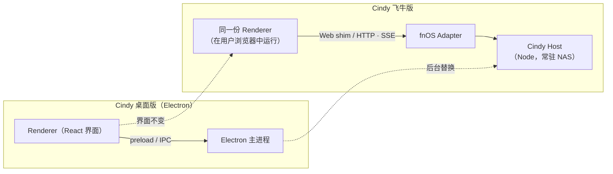
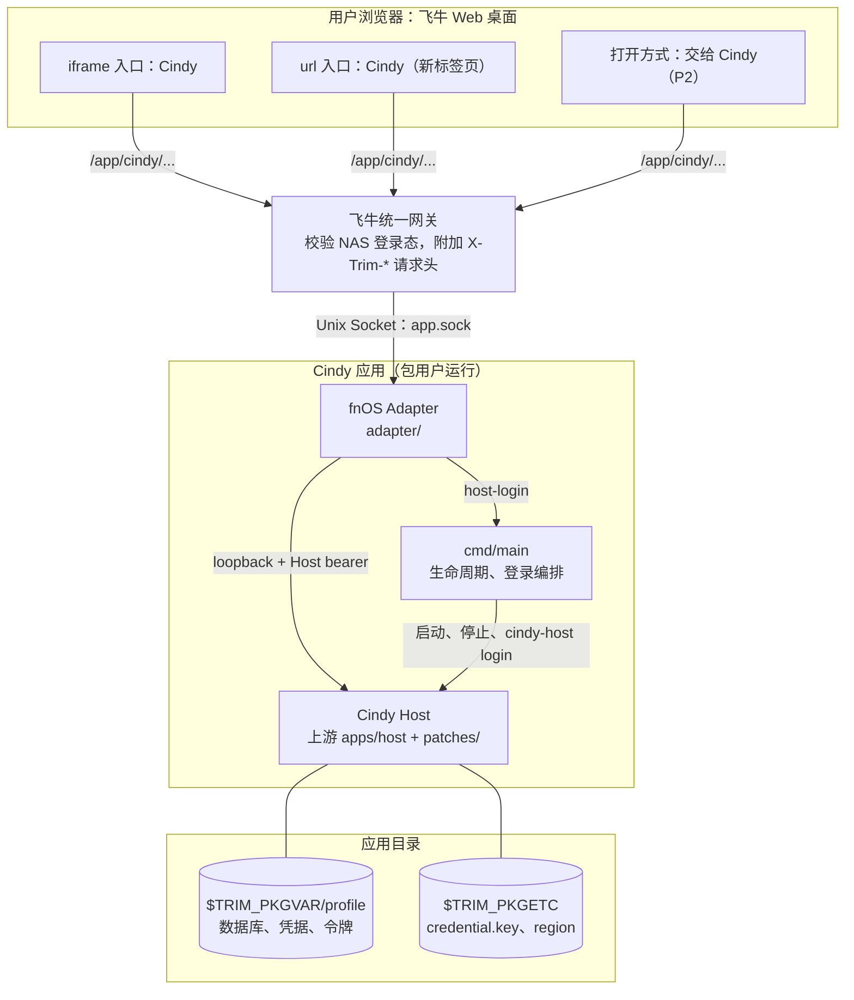
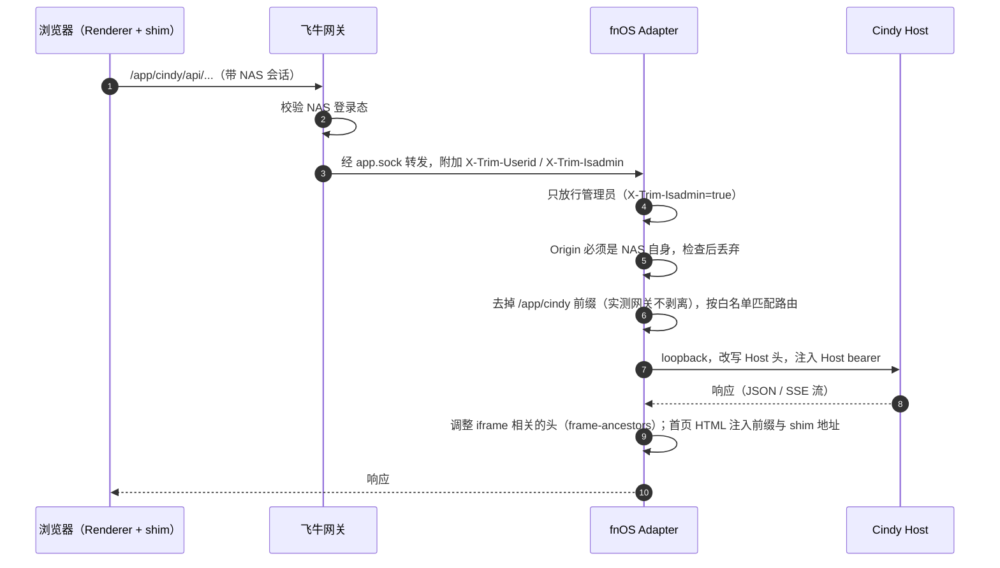
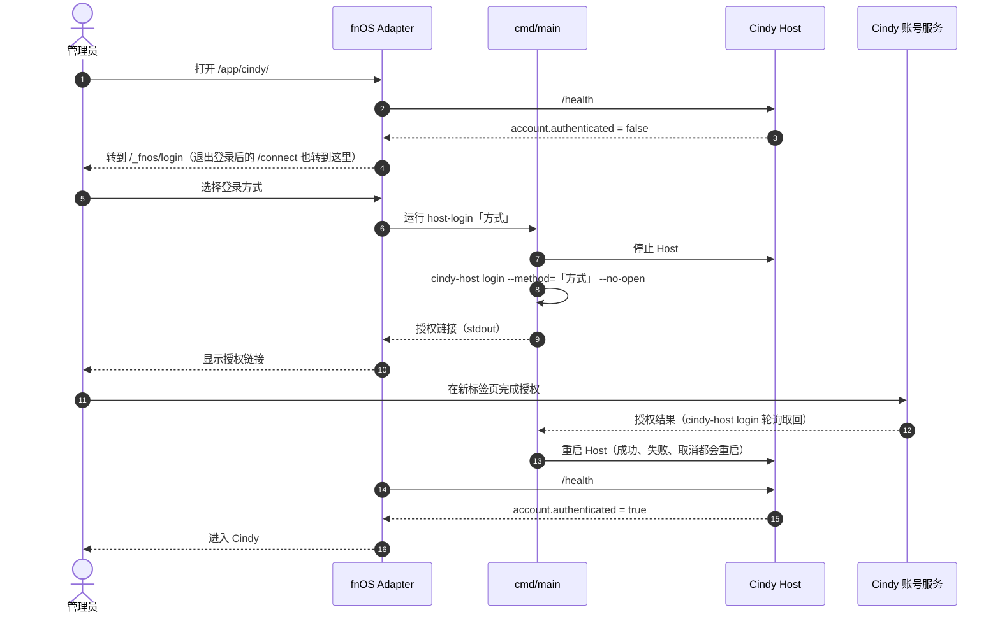

# 架构

> 本文回答：系统如何工作？为什么这样设计？做了哪些重要的技术取舍？
> 当架构或取舍发生变化时，必须同步更新本文。
> 标注「P2」的部分是已定的设计，尚未实现；进度见 [TODO.md](../TODO.md)。

## 1. 一句话

**Cindy 桌面版 = 前台 Renderer（React 界面）+ 后台 Electron 主进程。**
飞牛版保留前台不动，把后台换成 Cindy 官方的无界面 Host，再用一层 fnOS Adapter 接入飞牛的网关、窗口和原生能力。

## 2. 组件

| 组件 | 来源 | 职责 | 状态 |
|---|---|---|---|
| Renderer | 上游 `apps/desktop/src/renderer`，不修改 | 全部界面与交互；构建时 `vite build --base /app/cindy/` | 已实现 |
| Web shim | 上游 `apps/web/shim.js` + `patches/0004` | 在浏览器中提供 `window.electronAPI`，转发到 Host；`0004` 让请求带上子路径前缀 | 已实现 |
| Cindy Host | 上游 `apps/host` + `patches/` | Agent Runtime（只打包 Pi）、任务与消息、凭据、数据库、Chromium | 已实现 |
| fnOS Adapter | 本项目 `adapter/` | 飞牛网关与 Host 之间的身份、路由与安全边界；Cindy 之外的页面（登录、未就绪、错误） | 已实现 |
| `cmd/main` | 本项目 `fpk/cmd/main` | 启停 Host 与 Adapter、生成凭据密钥、按版本确定登录方式、编排网页登录 | 已实现 |
| 安装向导 | 本项目 `fpk/wizard/install`、`cmd/install_callback` | 选择 Cindy 版本（中国大陆版 / 国际版），写入 `$TRIM_PKGETC/region` | 已实现 |
| fnos-bridge | 本项目 `bridge/` | 用飞牛 JS SDK 覆盖依赖 Electron 原生能力的 `electronAPI` 方法（见第 5 节） | P2 |

## 3. 一次请求经过什么

浏览器里所有 Cindy 请求都走同一条路。Adapter 是唯一能接触 Host 的入口，Host 只监听 loopback。

- **白名单**（`adapter/lib/routes.mjs`）：只转发首页、`/shim.js`、`/assets/`、`/events`、`/chat`、`/api/`、`/health` 和 Renderer 的静态文件。`/control`、`/connect`、`/web` 等配对与控制接口一律不转发。
- **端口发现**：Host 每次启动的端口可能不同，Adapter 从 Host 写出的 `host-endpoint.json` 读取，Host 重启后重新读取。
- **Host 未就绪或请求被拒**：Adapter 返回自己的 503 / 403 页面，而不是白屏。

## 4. 首次登录

上游 `cindy-host login` 是命令行登录，并且要求 Host 未运行。Adapter 提供一个原版风格的网页登录页，由 `cmd/main` 在后台完成这套流程。等上游 Host 支持网页端登录（[#10600](https://github.com/makecindy/cindy/issues/10600)）后，这一层可以去掉。

- **登录方式按版本决定**（安装向导选择，`cmd/main` 读取 `region`）：中国大陆版是微信，国际版是 Google 和 Apple。手机号、邮箱登录上游 Host 还不支持。
- **登录期间**，`status` 仍然报告应用在运行，避免应用中心把它当成崩溃。
- **应用停止时**，`cmd/main` 用 `SIGUSR1` 让进行中的登录直接放弃，不再重启 Host。
- **已知限制**：中国大陆版微信登录遇到「需绑定手机号 / 选择账号」时失败（上游 [#10599](https://github.com/makecindy/cindy/issues/10599)）。

## 5. 飞牛原生能力（P2）

Renderer 中有一部分功能依赖 Electron 的系统能力，在 Web 版里显示为不可用。fnos-bridge 计划用飞牛开放 API 补上这些能力，在 Cindy shim 之后加载（Adapter 已预留注入位置 `EXTRA_SCRIPTS`）：

| 能力 | 桌面版 | 飞牛版 |
|---|---|---|
| 选择工作目录 | Electron `dialog` | `pickSharedFile({directory:true})`，选中后系统自动授予应用用户访问权限 |
| 打开文件 / 在文件夹中显示 | `shell.openPath` / `showItemInFolder` | `openFile` / `openFileManager` |
| 主题、语言 | 跟随操作系统 | `getPlatformConfig` + `$on('os/theme' / 'os/language')` |
| 窗口标题 | `BrowserWindow.setTitle` | `setTitle`，跟随当前任务名 |
| 路径展示 | 本地路径 | `convertPath`：`/vol1/1000/...` → 「我的文件/...」 |

如果当前环境不支持 JS SDK（系统版本低于 1.2.0401、在独立浏览器中打开、手机 App），则静默退回 shim 原本的行为。

## 6. 用户旅程

| 阶段 | 现在 | P2 |
|---|---|---|
| 安装 | 在应用中心安装，向导选择 Cindy 版本。首次启动时生成凭据密钥 `$TRIM_PKGETC/credential.key`，升级时保留 | 向导说明 Agent 能在授权目录内读写文件、执行命令；创建 `cindy/workspace` 共享目录 |
| 首次打开 | 转到 Adapter 登录页，登录后进入原版 Cindy（见第 4 节） | — |
| 日常使用 | 窗口里就是原版 Cindy | 默认工作区 `cindy/workspace`；选择目录时弹出飞牛原生选择器；Agent 的产物可以在飞牛文件管理器中打开 |
| 右键文件 | — | 「打开方式 → 交给 Cindy」进入交接页，选择新建任务或加入当前任务、选择工作目录；需要授权时调用 `authorizeUserFile`；入口可在应用设置里关闭，交接页提供「记住选择」 |
| 异常 | 启动失败的原因写到应用中心（`TRIM_TEMP_LOGFILE`）；Host 未就绪时显示 Adapter 的 503 页 | 运行中出错时显示可读的错误页 |
| 卸载 | 应用中心默认流程 | 卸载向导询问是否保留任务数据、凭据和工作区 |

## 7. 重要取舍

| 取舍 | 选择 | 放弃了什么 / 代价 |
|---|---|---|
| Renderer + Host，而不是 Electron + 远程画面（Xpra） | 界面由用户浏览器原生渲染，NAS 负载低，适配移动端 | Host 尚未实现的后台功能暂时不可用，需要等上游从 Electron 中拆出 |
| 反向代理 Adapter，而不是修改 Host 的安全校验 | Host 保持只监听 loopback 的安全边界，上游代码改动最少 | 多一个进程、多一跳代理 |
| 上游优先，而不是 fork | 长期能跟随上游更新 | 部分能力要等上游合入 |
| 应用自管凭据密钥，而不是系统密钥环 | NAS 重启后可以无人值守恢复 | 拿到 root 或磁盘就能解密 |
| 网页登录包装 `cindy-host login`，而不是自己实现登录协议 | 不碰上游的登录代码 | 登录时要停一次 Host；能用的方式受 CLI 限制 |
| 仅管理员、单账号 | 安全边界简单清晰 | 家庭其他成员暂时不能各用各的 |
| 只内置 Pi | 包更小，依赖更少 | 不能直接使用 Claude Code / Codex |

## 8. 为什么 Host 的功能比桌面版少

Cindy 最初是纯桌面产品，业务逻辑大量直接调用 Electron API。上游 2026-11-04 的分析显示，桌面主进程中有 485 个文件直接 `import 'electron'`，Agent 装配入口 `getMaker()` 的 177 个直接依赖里，有 118 个在 6 层引用之内会碰到 Electron。
上游正在把这些依赖改成注入式装配，每拆出一块，Host 就多一块能力。本项目**不参与这项重构**，只跟随上游的进度。
详见上游的 `docs/host/architecture-and-status.md` 与 `docs/host/maker-assembly-extraction-plan.md`。

## 9. 安全边界

1. **飞牛网关**只校验「已登录 NAS」。
2. **Adapter** 再校验「是管理员」、Origin 是 NAS 自身，并且只转发白名单内的路由。登录页和登录接口经过同样的校验。
3. **Host bearer** 只保存在服务端，不暴露给浏览器。授权链接只含 PKCE challenge 和 `client_state`（哈希），取回授权码用的 `pollSecret` 留在 `cindy-host login` 进程内。
4. **Agent** 以包用户身份运行，不用 root，不加入额外的用户组；只能访问工作区和管理员授权的目录。

另外两条实测结论约束了设计（见 [fnos-platform-notes.md](fnos-platform-notes.md)）：

- **存储空间带 `trimacl` 挂载，飞牛管理员组可以读取应用目录中 600 权限的文件**（凭据密钥、Host API token）。这与「Cindy 只对管理员开放」的信任边界一致，但文件权限只能挡住非管理员。
- **Cindy 页面与飞牛桌面同源，iframe 也没有 sandbox**。Cindy 页面中的脚本可以访问飞牛桌面，相当于拿到了当前用户的飞牛会话。因此 Agent 生成的 HTML 必须继续使用上游的沙箱渲染，不能放宽；Adapter 目前只设置了 `frame-ancestors`，严格的 CSP 列在 P2。

凭据与 API Key 只以加密形式保存在应用数据目录中，不进入日志、仓库或前端。
