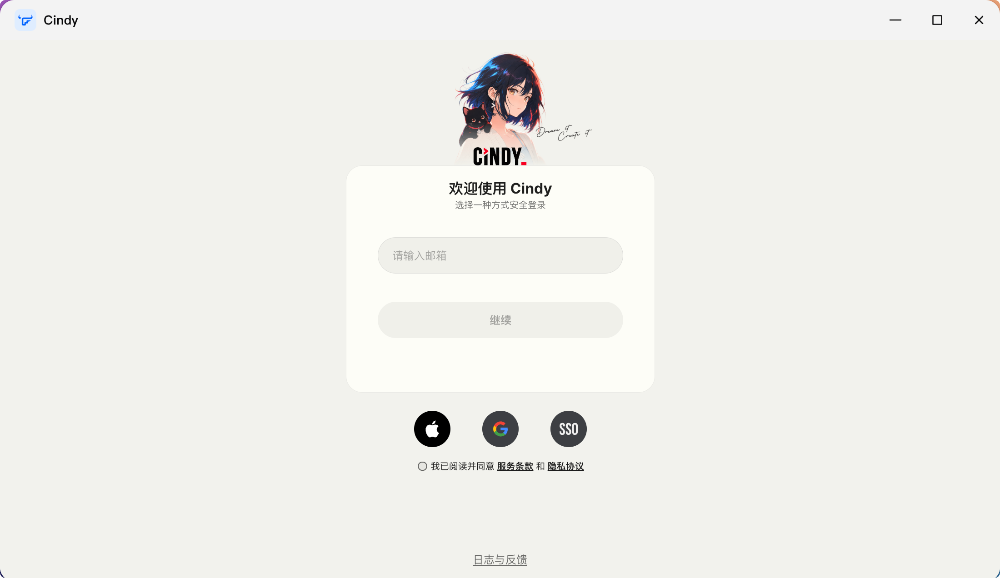
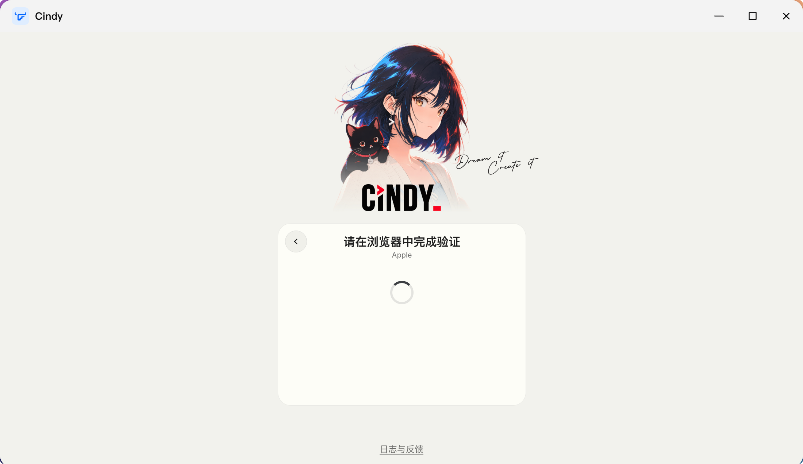
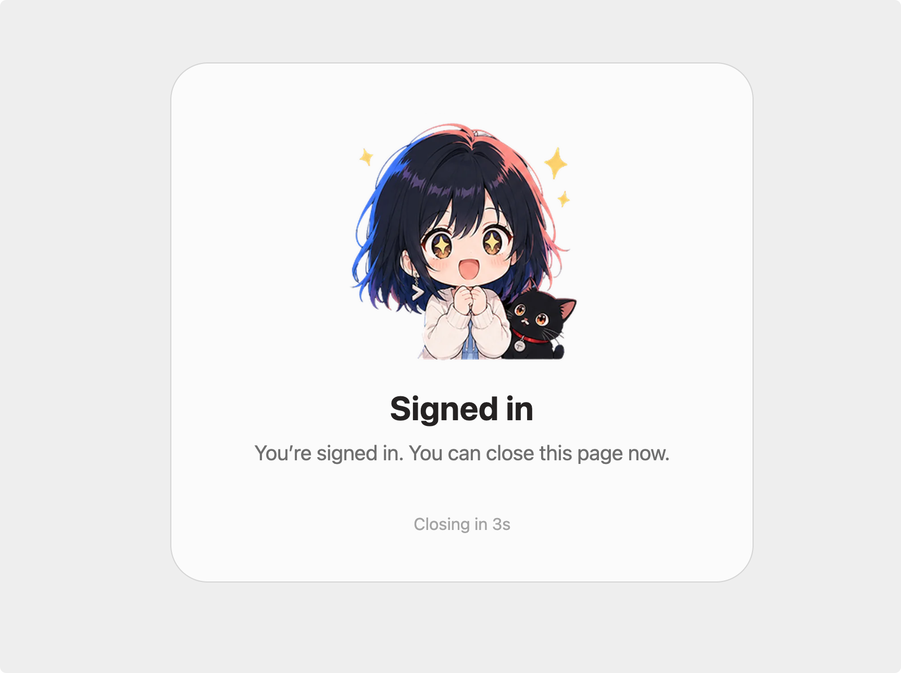
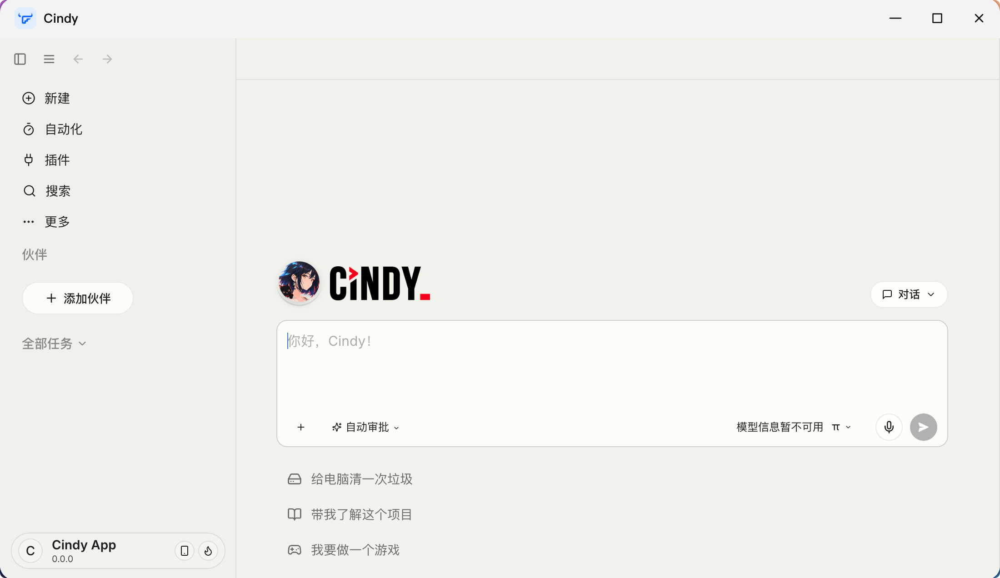
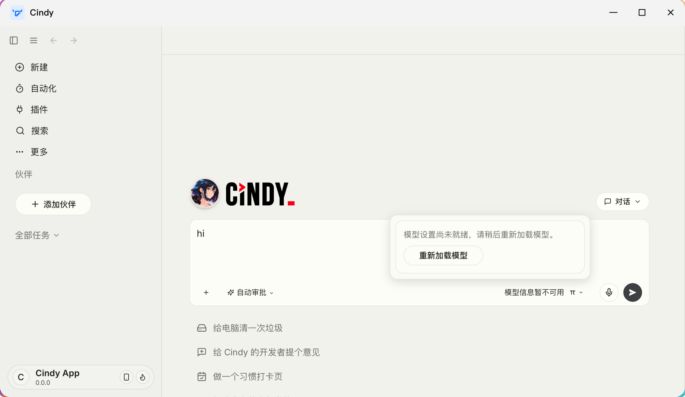
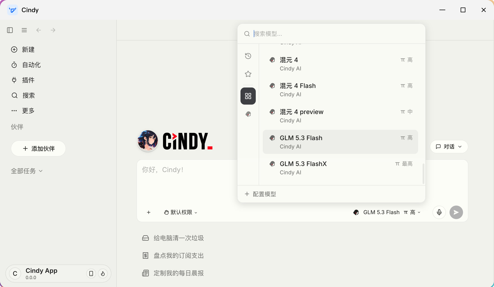
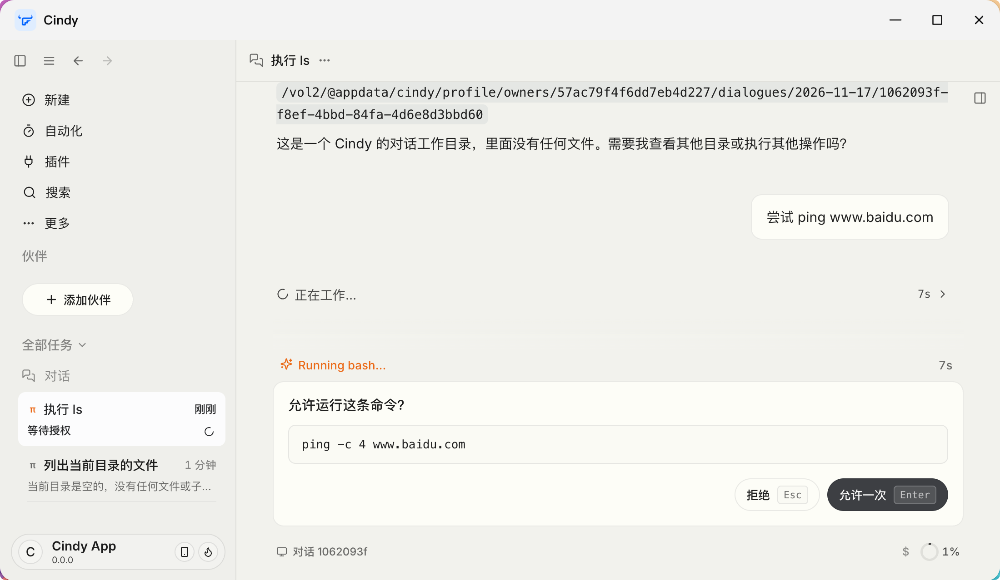
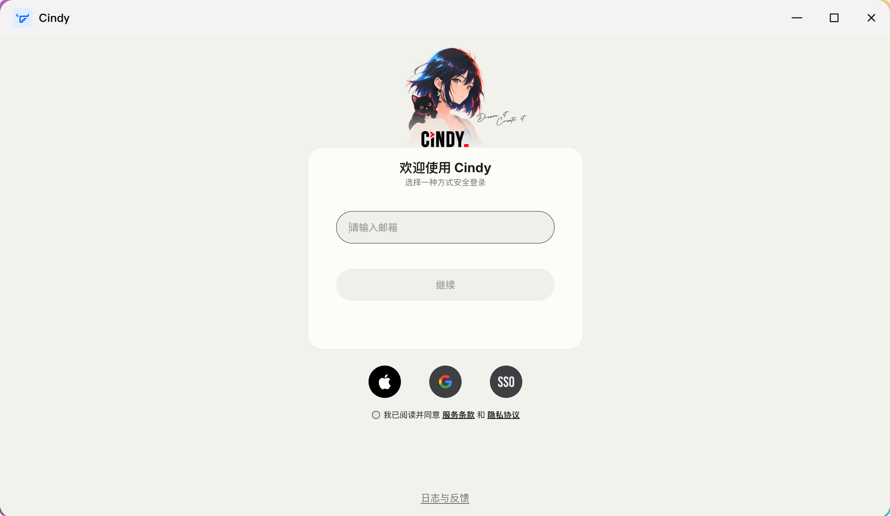

# feat(host): 支持网页首次登录与退出后重新登录

## 这次改了什么

### 摘要

独立 Host 无账号启动后，已配对浏览器可以通过原登录页完成社交登录或同区域企业 SSO，登录成功后直接装配账号运行时，无需停止或重启 Host。退出及账号过期后保留浏览器配对，通过账号状态事件回到登录页。

fnOS VM 实测发现：网页登录成功后已进入主界面，但模型选择器持续显示「模型设置尚未就绪，请稍后重新加载模型」，刷新页面仍不恢复，重启 Host 后正常。根因是 shim 两处把账号代次写死为 1，模型可见性 claim 又被同步缓存；进程内登录时 Host 与 providers 的真实代次为 3，renderer 因代次不一致进入 `owner-pending`。本 PR 已统一传递 Host 的真实代次，并在账号或代次变化时失效 claim 与侧栏同步快照；启动注入、账号事件及 SSE 重连状态读取共用该事实。

### 变更类型

- [x] `feat` 新功能
- [ ] `fix` 缺陷修复
- [ ] `refactor` / `perf` 重构或性能优化
- [ ] `docs` / `test` / `chore` 文档、测试或工程维护
- [ ] 其他：

### 范围

- 关联 Issue / 需求：关联 https://github.com/makecindy/cindy/issues/10600（第一阶段；验证码与绑定留待后续，本 PR 合入后 issue 保持打开）
- 本 PR 包含：Host 登录服务复用 `CindyAuthClient`、`reduceAuthFlow`、Desktop 参数校验及托管回调轮询；社交／同区域 SSO、选择账号、SSO 追加验证；认证 controller 写权限；Web shim 转发；安全存储与 `ensureRuntime`；登出保留配对；未登录 SSE 的账号事件通道。
- 明确不包含：手机／邮箱验证码及绑定（Turnstile）、跨区域 SSO、多账号切换、本地模式（#10601）、子路径（#10614）、Electron 客户端浏览器授权交接。
- 用户可见变化：登录页显示真实可用的社交入口及 SSO；浏览器打开授权页，原页面等待结果；退出后不再跳到 `/connect`。
- 是否存在 breaking change：无；新增接口仅供配套网页 shim 使用，普通 Desktop 启动流程不变。

### UI 变化

沿用原 renderer 登录页，未修改组件、布局、颜色或文案。fnOS VM 截图见「手工验证」；Light／Dark 未分别验收。窗口标题栏和外框属于 fnOS 桌面，内容为 Cindy 原版界面，本项目未添加页面元素。

- 引用的设计规范：`DESIGN.md` §1（复用既有组件与语义 token）、§7、`login-flow.md`（原登录页状态与浏览器授权等待／取消交互）。本次只接宿主能力，未新增视觉元素。

## 怎么验证的

### 自动验证

最终修复源码 `efd7535df6` 已在 Linux 构建机验证通过；最终单提交为 `a18aac9ec89e89a7b52fe1e3f781e8f1a3f04af4`；`git diff efd7535df6 HEAD` 为空，两者 tree 均为 `ee737a3c15c2963706de32b1b874e56d125d496e`。以下为本轮实际命令与结果。

```text
pnpm --filter desktop exec vitest related --run ../host/src/auth/login.mjs ../host/src/auth/web-login.ts ../host/src/main.ts ../host/src/server.mjs ../host/src/service.mjs ../web/shim.js ../../docs/dev-rules/protocol-compatibility/host-web-adapter-experimental.md ../../docs/host/basic-web.md ../../packages/maker-shared/src/hostChannelContract.ts
结果：1 文件，22/22，通过，69s

pnpm --filter desktop exec vitest run src/main/maker-host/__tests__/hostDesktopSourceContracts.guard.test.ts
结果：31/31，通过，2s

pnpm --filter desktop exec vitest run src/main/maker-host
结果：247 文件通过、8 跳过；4873 通过、80 跳过，89s

pnpm --filter @cindy/host test
结果：537/537，通过，39s

NODE_OPTIONS=--max-old-space-size=8192 pnpm --filter @cindy/host typecheck
结果：PASS，42s

maker-shared 契约测试
结果：2521/2521，通过

pnpm check:test-hygiene
结果：PASS

pnpm check:dev-docs
结果：PASS
```

Host 定向文件此前已通过：`auth/login.test.mjs` 12/12、`server.test.mjs` 27/27、`web-shim.test.mjs` 26/26。早期单文件秒级计时分别为 1s、不足 1s、代次修复前不足 1s；26 项版本未单独报告耗时，最终完整 Host 537/537 用时 39s。

Desktop related 命令覆盖本 PR 全部 9 个非测试文件。`hostDesktopSourceContracts.guard.test.ts` 通过文件读取检查源码文本，不建立可供 Vitest related 收集的生产模块导入关系，因此必须单独运行；本轮还运行了整个 Desktop `src/main/maker-host` 目录，覆盖 CI verify-checks 对应部分。跳过项按测试套件实际结果记录，未为本 PR 新增跳过。

Host 定向文件此前在 `8e6f933d93` 已通过：`auth/login.test.mjs` 12/12、`server.test.mjs` 27/27、`web-shim.test.mjs` 26/26；本轮 Host 全量包含这些用例。此前秒级计时：`auth/login.test.mjs` 1s、`server.test.mjs` 不足 1s、`web-shim.test.mjs` 在代次修复前不足 1s；26 项版本未单独报告耗时。maker-shared typecheck 在 `947fb154f5` 已通过，此后未改共享包源码。

本机已做 JS 语法检查与 `git diff --check`；工作树无 node_modules，按任务要求不安装依赖、不运行构建或全套测试。

测试价值（行为测试通过生产入口，unit；跨文件出口契约沿用已有 guard；已取得的单文件耗时及本轮未计时说明见上）：

- `hostDesktopSourceContracts.guard.test.ts`（guard）：首次网页登录尚无会话，不能复用按已存会话及设备身份构造的 client，因此 main.ts 预期构造计数由 2 调整为 3；新 client 满足全部 `hostAuthFetch` 断言及禁止 `globalThis.fetch` 的检查，没有放宽出口代理契约。
- `auth/login.test.mjs`：原 CLI 测试未覆盖网页状态机。最小输入为一个 Google 授权、两账号兑换结果、迟到回调及一个 SSO 追加验证；验证显示状态、令牌不出 Host、controller 争用、取消后的零凭证提交、SSO 真实动作及无认证上下文拒绝。
- `server.test.mjs`：真实 HTTP 入口验证无 owner 时可调用认证接口、caller 不信请求体、退出不清 Cookie；一个未就绪订阅分别接收历史与实时 owner 事件，必须过滤，只保留账号事件；就绪后正常事件与确认通道恢复，失效后重新过滤。同步调整原先要求账号退出撤销配对的断言。
- `web-shim.test.mjs`：执行实际打包 shim，最小动作是读取登录态、发起 SSO discovery、退出；验证真实路径／参数、弹窗拦截、唯一 SSO 异步自动启动复用预留标签页、账号过期事件投影及无 `/connect` 跳转；VM 代次回归覆盖未登录同步缓存 → `auth_changed` 代次 3 登录 → 同账号代次 4 → 退出，并覆盖启动代次及真实 SSE 重连后读取；真实 server + shim + protocol=2 经解码器验证隐藏事件间隙不会破坏游标，200 条隐藏事件不导致重连，只在可见性边界或隐藏后出现账号事件时重连。

### 手工验证

实测环境：fnOS 1.x arm64 VM，国际版 Apple 账号；fpk 0.1.4，补丁集对应集成分支 `900a2e5f70`（包含本 PR 的 `908a53606a` 和 `8e6f933d93` 修复）。Cindy 窗口运行在飞牛 iframe 内。下列截图的窗口标题栏和外框属于 fnOS 桌面，窗口内容为 Cindy 原版界面，本项目没有添加任何页面元素。

1. 原版登录页显示 Apple、Google、SSO 入口。

   

2. 点击 Apple 后弹出新标签页，iframe 内弹窗未被拦截；原页面等待浏览器授权，托管页显示已登录。授权完成后，无需刷新页面或重启 Host 即进入主界面。

   

   

3. 首轮发现网页登录后模型目录进入 `owner-pending`，模型选择器无法打开；页面刷新不能恢复，重启 Host 后正常。原因是 shim 写死账号代次 1 并缓存 claim，与进程内登录后的真实代次 3 不一致。

   

   

4. 修复后，网页登录即可打开模型选择器并选择 GLM 5.3 Flash，无需重启 Host。

   

5. 流式回复、权限确认和停止均正常。

   

6. 未登录空闲时，`/events` 只有 1 次连接，不再出现 409 轮询；重启 Host 后账号登录保持。

7. 退出账号后直接返回 Cindy 原版登录页，没有出现配对页，也没有跳转到 `/connect`。下图标题栏及外框同样属于 fnOS 桌面，窗口内容为 Cindy 原版登录页。

   

8. 随后用 Apple 重新登录成功，无需重新配对、刷新页面或重启 Host 即进入主界面，模型选择器正常。

9. VM 被强制断电并重启后，Host 自动启动，账号登录保持，凭据可读。


读写开销（代码推导，非实测）：首次获取登录页一次 providers 请求（并发合并）；社交授权不重复获取 providers；SSO discovery 每次一个请求。Host 托管回调轮询沿用 1 秒、30 秒后 2 秒退避及 5 分钟期限。网页只在浏览器授权等待时每秒串行读取 Host 登录态，完成／失败／取消／离页停止；每次状态读取不访问认证服务器。成功时一次 `getMe`、一次加密 session 写入，随后初始化原有运行时。账号状态通知复用同一 SSE，无新增常驻云轮询。账号就绪／未就绪的可见性边界可能新增一次 SSE 重连及一次账号状态读取；仅隐藏事件不增加重连。回包字节未测。

### 未执行的验证

Google／SSO、Light／Dark 分别目检、macOS／Windows 实机及完整 CI 尚未验证。fnOS VM 已通过上述 Apple 登录、模型目录及基础任务流程，不能据此声明其他平台或未测登录方式已通过。Linux 自动测试结果见上；本机未读取真实凭证或调用模型。

## 风险

### 风险分类

- [ ] 无已知风险
- [ ] SQLite / migration
- [ ] system prompt
- [x] 协议兼容
- [x] 权限 / 安全 / 用户数据
- [ ] 存量插件兼容（批准状态 / 指纹 / manifest 校验 / 安装布局 / 包格式）
- [ ] 原生层 / fingerprint / OTA
- [x] 跨平台差异
- [ ] 其他：

### 影响与回滚

- 影响范围：实验性独立 Host 网页认证。配对仍是当前进程内 12 小时 controller 授权；账号退出／过期不再撤销它，Host 重启仍需重新配对。登录展示状态是 Host 全局唯一，其他已配对管理员也能看到账号选择列表等进行中状态；`getLoginState` 不返回 authorizeUrl、ticket、pollSecret 或 verifier（回归断言覆盖）。账号登录写操作只接受传输认证的 caller，PKCE verifier、pollSecret、登录／验证 ticket 不返回浏览器；凭证使用现有系统加密存储，提交前验证身份与 profile 租约。预先取得的租约显式传给 `ensureRuntime`；提交前失败直接释放，交给运行时后由统一 `disposeOwnerRuntime` 在 finally 中释放并置空，登出与失效均走该路径。启动与网页登录共用 `activateAccountRuntime`，CLI 与网页登录共用 session 持久化函数。运行期 owner 固定，拒绝切到另一账号。
- SSE 放宽：允许无 owner 的已配对浏览器连接 `/events`。未就绪、暂停、退出期间历史和实时事件只放行 `auth_changed`，定向确认同样受就绪门约束；登录成功清空历史；可见性改变或隐藏后出现账号事件时，正常结束 SSE 并复用已有重连、`initial` 快照握手及账号状态重读，重新挂接确认通道，避免过滤后的序号缺口。未就绪重连不重放 owner 历史，隐藏事件本身不引发重连，不新增协议帧；旧客户端只看到已有握手及正常 EOF，Mobile／Device Link 协议未修改。测试覆盖过滤与恢复，这项放宽不放开账号业务接口。
- 跨平台：沿用原 credential store 与 Host 运行时，浏览器弹窗／系统 keyring 行为仍需实机验收。服务端返回需要手机／邮箱绑定时明确失败，不伪造登录完成。
- 回滚 / 降级方式：回退本提交后恢复 CLI 登录方式；已存 session 使用既有格式（含 Host device identity），不变更数据库 migration 或删除用户资料。旧网页不会获得新增登录能力。
- 存量插件影响：无；未修改插件契约、批准状态或装入逻辑。

本 PR 与同时提交的 #10614（子路径）、#10601（隐藏跳过登录）、#10644（自定义供应商）对应 PR 均修改 `apps/web/shim.js` 及其测试，彼此存在文本冲突；无论哪个先合入，其余 PR 均由提交者跟进变基。

### 提交前检查

- [x] 已 review 完整 diff
- [x] 每个 commit 都带 DCO 签名（`git commit -s`）
- [x] UI 改动已在「UI 变化」注明引用的设计规范章节
- [x] 未提交凭证、令牌或授权文件
- [x] 已核对受影响的文档，行为变化涉及的旧结论已同步修订
- [x] 已确认测试结果或说明未执行原因
- [x] 已在「怎么验证的」写明新增请求／轮询次数及停止条件，字节未实测
