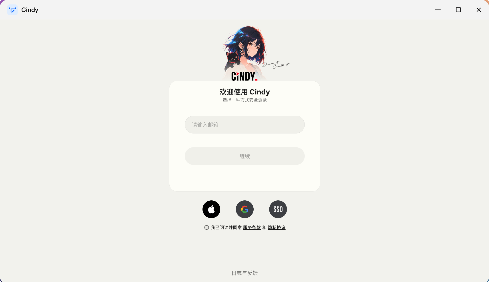

# fix(web): 隐藏独立 Host 尚不支持的跳过登录入口

## 这次改了什么

### 摘要

独立 Host 尚不能创建本地身份，网页端却提供「跳过登录」。此前点击并同意协议后只重新查询认证状态，仍停留在未登录页，也没有错误反馈。本次隐藏网页端两处跳过入口，并让直接调用网页 shim 的本地模式动作明确拒绝。

沿用 `electronAPI.hostConnection.client === 'browser'` 判断运行端：网页 shim 的 Proxy 会为未知属性合成函数，即使删除路由，方法存在性检查仍会得到函数，无法据此判断能力。`AuthContext` 在浏览器端提供 `enterLocalMode: null`，`useLogin` 透传该显式不可用状态，登录页仅据此隐藏面板入口和准备／离线／错误态的底部入口；缺省值保留桌面原有显隐行为。

### 变更类型

- [ ] `feat` 新功能
- [x] `fix` 缺陷修复
- [ ] `refactor` / `perf` 重构或性能优化
- [ ] `docs` / `test` / `chore` 文档、测试或工程维护
- [ ] 其他：

### 范围

- 关联 Issue / 需求：https://github.com/makecindy/cindy/issues/10601 （仅处理已确认的网页死入口；Host 免账号本地模式仍待独立规划，本 PR 不宣称完成该能力需求。）
- 本 PR 包含：网页 shim 明确拒绝本地模式动作；共享认证上下文、登录 hook 与登录页透传并使用不可用状态；对应回归测试。
- 明确不包含：Host 本地 owner、免账号建库、服务端修改、其他登录 UI 调整、新能力配置。
- 用户可见变化：独立 Host 网页登录页不再显示无法生效的「跳过登录」。
- 是否存在 breaking change：无新增外部协议变化；网页端此前不能生效的动作现在明确拒绝。

### UI 变化

Web 登录页隐藏面板内的跳过按钮及准备／离线／错误态底部入口，保留原布局尺寸。Light / Dark 共享相同显隐条件，不新增颜色或样式。

截图：已完成 fnOS VM 独立 Host 网页端 Light 模式目检，见下方「手工验证」；Dark 模式尚未目检。Linux 构建机无显示环境，自动 UI 检查启动 Electron 时失败（`Process failed to launch!`）。

- 引用的设计规范：`docs/design-rules/login-flow.md` §16.2（登录面板几何保持不变）、§16.3（复用现有登录组件与入口）；`docs/design-rules/DESIGN.md` §10 Light / Dark 双模式交付门槛。隐藏条件同时应用两模式，未改 token；是否完成目检以验证记录为准。入口收敛依据 `docs/host/basic-web.md`「每个仍可点击的未支持入口须明确不可用，不能静默吞掉操作」。

## 怎么验证的

### 自动验证

协调者在 Linux 构建机按 main 锁文件安装依赖并串行验证，`c3db195107` 的 related、登录回归、shim、Desktop 类型检查及测试规范检查均通过。两个提交已压为单个 DCO 提交 `49ede1839d5ec8e36602da9b62396ad8dba560dd`，`git diff c3db195107 HEAD` 为空，文件树完全相同。此前 CI 暴露的 3 个既有登录测试文件共 9 个失败用例已通过显式 `null` 修复，未修改这 3 个测试文件。

```text
# apps/host 目录
node --import tsx --import ./src/loaders/register-raw.mjs --test src/web-shim.test.mjs
结果：19/19 通过（c3db195107）。最终轮次未提供独立耗时；初版独立命令墙钟 1s，Node test runner 报告 261.52ms。

# 仓库根目录
pnpm --filter desktop exec vitest related --run src/renderer/contexts/AuthContext.tsx src/renderer/hooks/useLogin.ts src/renderer/components/login/LoginPage.tsx ../web/shim.js
结果：333 个文件，6907 个用例通过、1 个跳过，命令墙钟 263s；覆盖本 PR 全部非测试文件。

pnpm --filter desktop exec vitest run src/renderer/components/login/__tests__/LoginPage.browserRedirect.test.tsx src/renderer/components/login/__tests__/LoginPage.errorCopy.harness.test.tsx src/renderer/components/login/__tests__/LoginPage.harness.test.tsx
结果：CI 此前失败的 3 个文件，89/89 通过，命令墙钟 4s。

pnpm --filter desktop exec vitest run src/renderer/contexts/__tests__/AuthContextInitializeCatch.test.tsx src/renderer/components/login/__tests__/LoginPage.consent.test.tsx src/renderer/components/login/__tests__/LoginPage.initialization.test.tsx src/renderer/components/login/__tests__/LoginPage.region.harness.test.tsx src/renderer/__tests__/authContextSessionBoundary.test.tsx
结果：5 个文件，103/103 通过，命令墙钟 6s（c3db195107）。
初版同组测试也为 103/103 通过（Vitest 总耗时 5.60s，命令墙钟 6s）。初版日志中的测试执行耗时（不是单文件独立运行墙钟）：LoginPage.consent 628ms、AuthContextInitializeCatch 922ms、authContextSessionBoundary 1344ms；其余两文件未保留逐文件耗时。

NODE_OPTIONS=--max-old-space-size=8192 pnpm --filter desktop typecheck
结果：PASS，命令墙钟 242s；类型检查分片合计覆盖 10286 个文件（c3db195107）。

pnpm check:test-hygiene
结果：PASS（c3db195107）；初版也为 PASS（336 files within baseline，36s），最终轮次未提供独立耗时。

pnpm ui:check --changed --theme all
结果：未完成；Linux 构建机无显示环境，Electron 启动失败（Process failed to launch!），命令墙钟 1050s。没有产出可用的双模式目检证据，不视为通过。
```

本机 `git diff --check` 通过；`node scripts/check-test-hygiene.mjs` 因未安装依赖、找不到 `typescript` 未完成。未安装依赖、运行构建或完整测试。

测试价值（均并入已有文件，tier 为 unit）：

| 文件 | 生产入口与可观察结果 | Bug／覆盖缺口与最小失败输入 | 单独实测耗时 |
| --- | --- | --- | --- |
| `apps/host/src/web-shim.test.mjs` | 编译并执行真实 shim，调用公开 `authEnterLocal` 明确拒绝且不发送认证查询；`authInitialize` 保留真实 Host 状态投影 | #10601；原测试接受查询替代动作，无法发现静默无效；最小输入为浏览器 shim 直接进入本地模式 | 独立命令墙钟 1s（runner 261.52ms） |
| `AuthContextInitializeCatch.test.tsx` | 真实 `AuthProvider` 与 `useLogin`，浏览器端不暴露动作、桌面及旧 bridge 仍暴露动作 | #10601；既有用例只有桌面失败／竞态分支；最小输入 `hostConnection.client='browser'`，对照 `'desktop'` 和缺省标识 | 未独立计时；组合运行测试执行 922ms |
| `LoginPage.consent.test.tsx` | 渲染真实 `LoginPage`，不可用动作下两处入口均不存在 | #10601；既有协议门用例仅覆盖可用动作；最小输入 `enterLocalMode=null`，覆盖 entry、identifier、准备与错误态 | 未独立计时；前版组合运行测试执行 628ms；最终 5 文件合计墙钟 6s |
| `authContextSessionBoundary.test.tsx` | 保留原有本地模式 owner 切换测试，只为可选动作类型增加桌面用例的非空断言 | 无新增用例或结果断言；原断言不减弱，防止共享类型调整破坏编译 | 未独立计时；组合运行测试执行 1344ms |

Red/Green：main 生产代码搭配前版新测试时，shim 的本地进入拒绝用例失败（`Missing expected rejection`），Vitest 的 browser 动作投影和登录页隐藏用例失败，其余 101 项通过；Red Vitest 总耗时 5.68s、命令墙钟 7s。最终文件树经 c3db195107 验证：related 333 文件、6907 通过／1 跳过（263s），CI 失败文件 89/89（4s），原 5 文件 103/103（6s），shim 19/19、Desktop 类型检查（242s）和测试规范检查均通过。

桌面端行为不变的依据：preload 的标识为 `'desktop'`，仍得到原动作；主进程、`authService` 与原有 `AuthContext.enterLocalMode` 的 owner 边界和状态更新代码均未改动。既有协议门、同意记录晚于本地模式进入（#907）及 owner 状态切换（#3201）断言保留，Linux 定向回归 103/103、related 扩大回归及 Desktop 类型检查均已通过；CI 暴露的缺省动作显隐兼容问题已用显式 `null` 修复，原有 3 个失败文件另行验证 89/89 通过。

### 手工验证

协调者在 fnOS VM 上验证独立 Host 网页端，使用含提交 `a61f3c8` 的 fpk `0.1.4`：打开 Cindy 原版登录页（Light 模式），确认面板内和底部均没有「跳过登录」入口。



截图中的窗口标题栏和外框属于 fnOS 桌面窗口，内容为 Cindy 原版登录页，本项目未添加页面元素。页面邮箱输入框来自 #10600 第一阶段尚未接通的验证码登录，与本 PR 无关。本次只验证入口隐藏，不代表完整登录链路通过。

读写开销：新增判断读取现有同步客户端标识，不新增 IPC、HTTP、扫描、事务、轮询或订阅。浏览器端被移除的入口不再触发动作；直接调用 shim 则在本地拒绝，新增回归断言该调用产生 0 次 HTTP 请求。不涉及通知或后台生命周期变化。

### 未执行的验证

- 本机无 `node_modules`，按协调工作流不运行完整测试、构建或安装依赖；上述 Linux 检查已由协调者串行执行通过。
- Linux 的 `pnpm ui:check --changed --theme all` 因无显示环境、Electron 启动失败而未完成；另已取得上述 fnOS VM 的 Light 模式实包截图，Dark 模式尚未目检。
- Web 与 Desktop 的完整登录／协议门实机操作尚未执行；Desktop 实机目检尚未执行。
- macOS／Windows／Linux 发行包尚未验证；fnOS fpk `0.1.4` 仅验证了上述网页登录页入口隐藏，没有使用真实账号、创建 owner 数据库或调用模型。
- 本次压缩提交未推送，未发布素材或修改线上 PR／issue；此文件为 PR 正文草稿。

## 风险

### 风险分类

- [ ] 无已知风险
- [ ] SQLite / migration
- [ ] system prompt
- [ ] 协议兼容
- [ ] 权限 / 安全 / 用户数据
- [ ] 存量插件兼容（批准状态 / 指纹 / manifest 校验 / 安装布局 / 包格式）
- [ ] 原生层 / fingerprint / OTA
- [x] 跨平台差异
- [x] 其他：Web 与 Desktop 复用认证上下文，需核验桌面跳过登录流程。

### 影响与回滚

- 影响范围：浏览器登录页显隐和网页 shim 的直接本地模式调用。桌面原生登录能力、协议同意顺序及 owner 切换实现保留；CI 发现的缺省动作兼容问题修复后，Linux related 扩大回归、定向回归、shim、类型检查及测试规范检查均通过，实机验证限制见上文。
- 回滚 / 降级方式：回退本次提交即可恢复原行为；不修改持久数据、凭据、数据库或 wire protocol，无数据迁移。
- 边界：本次未让 Host 支持免账号使用；浏览器端需使用 Host 已支持的认证方式。已构建的旧 renderer 需更新至本次源码构建后才会隐藏入口。

本 PR 与同时提交的 #10614（子路径）、#10600（网页登录）、#10644（自定义供应商）对应的 PR 均修改 `apps/web/shim.js` 及其测试，彼此会有文本冲突；无论合入顺序如何，其余 PR 均由提交者跟进变基。

### 提交前检查

- [x] 已 review 完整 diff
- [x] 每个 commit 都带 DCO 签名（`git commit -s`）
- [x] UI 改动已在「UI 变化」注明引用的设计规范章节
- [x] 未提交凭证、令牌或授权文件
- [x] 已核对受影响的文档：`basic-web.md` 的不可静默吞操作要求及本地模式规划边界不变；历史验证记录无需改写
- [x] 已确认测试结果或说明未执行原因（已回填最终文件树的扩大回归结果，UI 环境限制如实记录）
- [x] 已在「怎么验证的」说明请求／读写次数与后台行为
