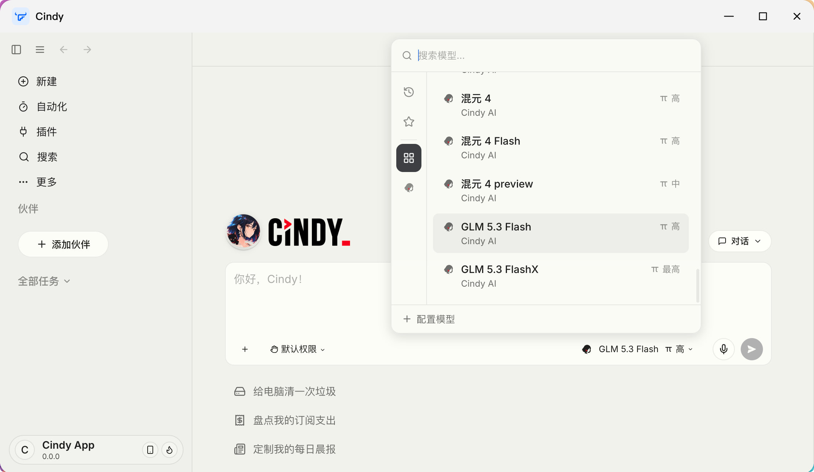

# PR 草稿：网页端支持部署在反向代理的子路径下

> 状态：**草稿**，变基后自动验证已通过，待用户审阅。
> 关联 issue：makecindy/cindy#10614（分诊机器人已建议推进并欢迎提交 PR）
> 分支：`feat/web-base-path`，基于上游 `origin/main`（`fe0daea10e`），单个 DCO 提交 `25d5629441`。
> 模板：上游 `.github/PULL_REQUEST_TEMPLATE.md`
> 2026-11-17 变基：`shim.js` 自动合并；`web-shim.test.mjs` 保留主干的安装/业务确认测试（不恢复已移除的 `requestTaskApproval`），加入两个子路径测试。保留主干启动检查、模型组读取等既有修复。
> 历史本地补丁与旧集成分支不作为本次变基验证依据；测试结果由协调端在 Linux 构建机补齐（2026-11-17，提交 `25d5629441`）。

---

**标题**：`feat(web): 网页端支持部署在反向代理的子路径下`

## 这次改了什么

### 摘要

网页端的 shim 请求 Host 时用的都是从根开始的路径（`/api`、`/chat`、`/events`），退出登录时跳到 `/connect`。反向代理把网页端放在某个前缀下（例如 NAS 应用网关的 `/app/cindy/`、Nginx 的 `location /cindy/`）时，这些请求都会离开前缀。本 PR 让 shim 读取代理在页面里设置的 `window.__CINDY_BASE__`，把它加在这些路径前面。未设置时行为不变；不是同源路径的值会被忽略，避免退出跳转离开当前站点。Host 本身不需要任何改动：代理去掉前缀后转发。

### 变更类型

- [x] `feat` 新功能

### 范围

- 关联 Issue / 需求：Closes #10614
- 本 PR 包含：
  - `apps/web/shim.js`：读取并校验 `window.__CINDY_BASE__`（去掉末尾的 `/`；只接受以单个 `/` 开头、不含反斜杠的路径），加在 `requestHost`（覆盖所有 RPC）、`/chat`、`/events` 请求和 `authLogout` 的跳转地址前面；
  - `apps/host/src/web-shim.test.mjs`：新增 2 个用例；测试辅助函数识别事件流请求的条件从 `startsWith('/events')` 改为 `includes('/events?')`，以便识别带前缀的地址；
  - `docs/host/README.md`：新增「部署在反向代理的子路径下」一节，说明构建（`vite build --base`）、代理（去掉前缀、负责身份校验）和首页改写（设置 `__CINDY_BASE__`、改写 shim 地址）三件事。
- 明确不包含：
  - Host 的路由和 `server.mjs` 注入首页的 `<script src="/shim.js">`：由代理改写，Host 不感知前缀；
  - 配对页 `/connect` 和 `/connect.js`：仍按根路径工作，文档里写明经代理部署时不要依赖它；
  - 从 `location` 或脚本地址自动推算前缀。
- 用户可见变化：经反向代理部署在子路径下的网页端可以正常使用。直接访问 Host（未设置前缀）时没有变化。
- 是否存在 breaking change：无。

### UI 变化

不涉及：只改变请求地址，没有界面、样式或文案改动。

- 引用的设计规范：不涉及。

## 怎么验证的

### 自动验证

```text
cd apps/host && node --import tsx --import ./src/loaders/register-raw.mjs --test src/web-shim.test.mjs
结果：20/20 通过，命令墙钟 0s（协调端秒级计时，不足一秒）
pnpm --filter @cindy/host test
结果：520/520 通过，37s
NODE_OPTIONS=--max-old-space-size=8192 pnpm --filter @cindy/host typecheck
结果：PASS，44s
pnpm check:test-hygiene
结果：PASS，336 files，27s
pnpm check:dev-docs
结果：11/11 通过，1s
```

以上由协调端在 Linux 构建机串行执行；本机仅完成 diff 与 DCO 检查，未安装依赖、未运行测试。

测试价值（`web-shim.test.mjs`，补充到现有文件）
- 生产入口与可观察结果：浏览器 shim 公开的 `window.electronAPI`（`auth.getState`、`maker.send`、`authLogout`）和它自动建立的事件流；可观察结果是发出的请求地址和退出后的跳转地址。
- Bug／规则依据：#10614。前缀会进入退出后的 `location.replace`，所以只能接受同源路径。
- 现有覆盖缺口：现有用例都在根路径下运行（它们断言的 `/api/...` 地址守住了「未设置时行为不变」），没有用例设置前缀。
- 最小失败输入：
  - 前缀 `'/cindy/'`：一次 RPC、一次 `maker.send`、事件流和一次退出，地址必须是 `/cindy/api/auth/state`、`/cindy/chat`、`/cindy/events?…`、`/cindy/api/auth/logout`，跳转到 `/cindy/connect`（修改前全部是根路径）；
  - 不合法的值（`https://evil.example`、`//evil.example`、`/\evil.example`、非字符串）：表驱动，请求和跳转必须保持根路径（直接使用该值的实现会跳到外站）。
- tier：unit，复用文件内已构建的 shim，无 I/O 和 socket。
- 实测耗时：协调端报告变基后单独运行该文件 0s（秒级计时，不足一秒）。

### 手工验证

协调端已在 fnOS VM 实测 fpk `0.1.4`：Host 使用 `CINDY_WEB_BASE=/app/cindy/` 构建，补丁集等于集成分支 `900a2e5f70`，其中本 PR 的子路径部分等于 `25d5629441`。

Cindy 通过飞牛应用网关挂在 `/app/cindy/` 下；Adapter（本项目的反向代理）去掉前缀后转发，并设置 `window.__CINDY_BASE__`。Adapter 日志确认页面的 `/api/*`、`/events`、`/chat` 及静态资源请求全部经由该前缀到达。登录、模型选择、发送消息、流式回复、权限确认、停止、登出均正常。登出后不再跳转是 #10600 决定的组合行为，见 #10600；本 PR 单独的退出跳转行为仍由上述单元测试覆盖。

子路径下模型选择器正常工作的截图（fnOS 外框内为 Cindy 原版界面）：



### 未执行的验证

- 其他反向代理（nginx / Caddy）未实测。
- Host 自带的网页配对流程：经代理部署时不走配对页（见「明确不包含」）。
- Windows / macOS：改动只在浏览器端的 shim 中，与 Host 所在平台无关，未分平台验证。

## 风险

### 风险分类

- [x] 无已知风险

### 影响与回滚

- 影响范围：只影响浏览器 shim 拼出来的请求地址和退出跳转地址；未设置 `__CINDY_BASE__` 时所有地址与现在相同。Desktop 不加载 shim。
- 回滚 / 降级方式：回退本 commit 即可。

本 PR 与同时提交的 #10600（网页登录）、#10601（隐藏跳过登录）、#10644（自定义供应商）对应的 PR 均修改 `apps/web/shim.js` 及其测试，彼此会有文本冲突；无论先合入哪一个，其余 PR 都由提交者跟进变基。

### 提交前检查

- [x] 已 review 完整 diff
- [x] 每个 commit 都带 DCO 签名（`git commit -s`，见 [DCO](../DCO)）
- [x] UI 改动已在「UI 变化」注明引用的设计规范章节（不涉及 UI 则跳过）
- [x] 未提交凭证、令牌或授权文件
- [x] 已核对受影响的文档，行为变化涉及的旧结论已同步修订（不涉及则无需修改文档）
- [x] 已确认测试结果或说明未执行原因
- [x] 涉及数据读取、通知后刷新、界面频繁写入或常驻组件时，已在「怎么验证的」写明：每个用户动作
  和每次通知触发几次 list/扫描/IPC/写事务（读远程数据再写远程调用次数和回包字节），以及隐藏或
  卸载后是否停止（见 `docs/dev-rules/engineering-conventions.md` §8；远程读取同时见
  `docs/dev-rules/server-channel-review.md`）（不涉及：请求次数不变，只改地址）
