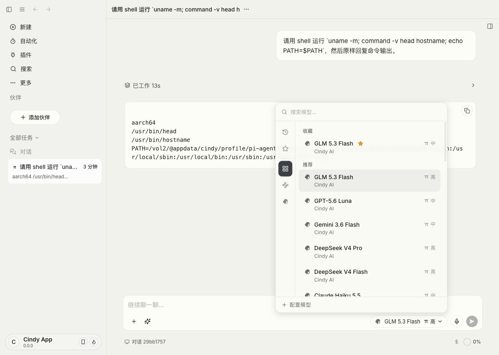

# PR 草稿：网页 shim 的模型组读取明确报「不支持」，不再返回 null

> 状态：**已提交**（经用户审阅）：https://github.com/makecindy/cindy/pull/10643
> 关联 issue：makecindy/cindy#10641
> 分支：本地 `.upstream/cindy` 中的 `fix/web-model-groups-unsupported`，基于上游 `main`（`b975dc3`），1 个 commit，带 DCO 签名。
> 模板：上游 `.github/PULL_REQUEST_TEMPLATE.md`
> 与其他 PR 的关系：和 #10598、子路径 PR 都改 `apps/web/shim.js` 与 `apps/host/src/web-shim.test.mjs`，改动位置不重叠。
> 验证数据均为实测（2026-11-15，构建机 linux-arm64，Debian 12，Node 22.22.3，pnpm 11.28.9；手工验证在飞牛 fnOS 虚拟机）。

---

**标题**：`fix(web): 模型组读取明确报不支持，避免模型选择器崩溃`

## 这次改了什么

### 摘要

Host 还没有模型组，网页 shim 对未实现的 `modelGroups.get` 走通用读方法兜底，返回 `null`。renderer 把它当作模型组配置，打开模型选择器时读 `config.routes` 崩溃。本 PR 在 shim 中把 `modelGroups.get` 声明为不支持（reject `HOST_CHANNEL_UNSUPPORTED`）；`modelGroupsClient` 本来就会捕获这个失败并保留内置的空默认值。

### 变更类型

- [x] `fix` 缺陷修复

### 范围

- 关联 Issue / 需求：Closes #10641
- 本 PR 包含：
  - `apps/web/shim.js`：新增 `'modelGroups.get'` 路由，返回 `Promise.reject(unsupportedHostChannel('modelGroups.get'))`，并注明原因；
  - `apps/host/src/web-shim.test.mjs`：新增回归用例。
- 明确不包含：
  - Host 实现模型组（`docs/host/channel-coverage.md` 中 `model-groups:*` 七个通道）；
  - 修改 `unsupported()` 的通用兜底规则（影响面大，其他读方法依赖它返回占位形状）；
  - `modelGroups` 的其他方法：`set`、`resolve`、`commit` 等不以读前缀开头，已经会 reject；`resolve` 的调用方也已捕获失败。
- 用户可见变化：网页端打开模型选择器不再崩溃；选择器中不显示模型组（Host 尚不支持）。
- 是否存在 breaking change：无。

### UI 变化

不涉及界面代码：只改变 shim 的返回值。效果是模型选择器能正常打开，截图见「手工验证」。

- 引用的设计规范：不涉及：没有修改界面、样式或文案。

## 怎么验证的

### 自动验证

```text
cd apps/host && node --import tsx --import ./src/loaders/register-raw.mjs --test src/web-shim.test.mjs
结果：17 pass，0 fail，约 0.3 秒
（只保留新测试、换回 main 的 shim.js：16 pass，1 fail，失败的是新用例）
pnpm --filter @cindy/host test
结果：447 pass，0 fail
pnpm check:test-hygiene
结果：PASS（341 files within baseline）
```

测试价值（`web-shim.test.mjs`，补充到现有文件）
- 生产入口与可观察结果：浏览器 shim 公开的 `window.electronAPI.modelGroups.get()`，即 `modelGroupsClient.refreshModelGroups()` 读取模型组配置的入口；可观察结果是它 reject 而不是解析为 `null`。
- Bug／规则依据：#10641；`docs/host/maintenance-plan.md` 第一批「已明确未实现的设置……返回明确错误」。
- 现有覆盖缺口：「unsupported web actions」用例只覆盖写操作；读方法走兜底，没有用例检查兜底值会不会被 renderer 当成真实数据。
- 最小失败输入：调用一次 `modelGroups.get()`（修改前解析为 `null`）。
- tier：unit，复用文件内已构建的 shim，无 I/O。
- 实测耗时：单独运行该文件约 0.3 秒（墙钟）。

### 手工验证

飞牛 fnOS 1.2.1010（linux-arm64）虚拟机，只打包 Pi 的独立 Host，浏览器经反向代理访问：

| | 修改前 | 修改后 |
|---|---|---|
| 点击模型选择器 | 主区域变成「界面出错了」，`TypeError: Cannot read properties of null (reading 'routes')` | 选择器正常打开，列出 Pi 可用的模型 |

修改后的选择器：



修改后的验证是把同样的一行加到发行包已构建的 `resources/web/shim.js` 中、重启 Host 后进行的。拍摄时 VM 上还临时带着 capabilities 问题（#10640）的修复，否则只打包 Pi 时选择器里没有模型。

### 未执行的验证

- 打包全部 agent 的发行包：没有另行构建；修复只改变 `modelGroups.get` 的返回，与打包哪些 agent 无关。
- 「设置 → 模型组」页面：同样读取 `modelGroups.get`，`refreshModelGroups` 捕获失败后显示空默认值，未单独截图确认。

## 风险

### 风险分类

- [x] 无已知风险

### 影响与回滚

- 影响范围：只影响网页端的 `modelGroups.get`；Desktop 不加载 shim。
- 回滚 / 降级方式：回退本 commit 即可。

### 提交前检查

- [x] 已 review 完整 diff
- [x] 每个 commit 都带 DCO 签名（`git commit -s`，见 [DCO](../DCO)）
- [x] UI 改动已在「UI 变化」注明引用的设计规范章节（不涉及 UI 则跳过）
- [x] 未提交凭证、令牌或授权文件
- [x] 已核对受影响的文档，行为变化涉及的旧结论已同步修订（不涉及则无需修改文档）
- [x] 已确认测试结果或说明未执行原因
- [x] 涉及数据读取、通知后刷新、界面频繁写入或常驻组件时，已在「怎么验证的」写明：每个用户动作
  和每次通知触发几次 list/扫描/IPC/写事务（读远程数据再写远程调用次数和回包字节），以及隐藏或
  卸载后是否停止（见 `docs/dev-rules/engineering-conventions.md` §8；远程读取同时见
  `docs/dev-rules/server-channel-review.md`）（不涉及：不增加请求）
