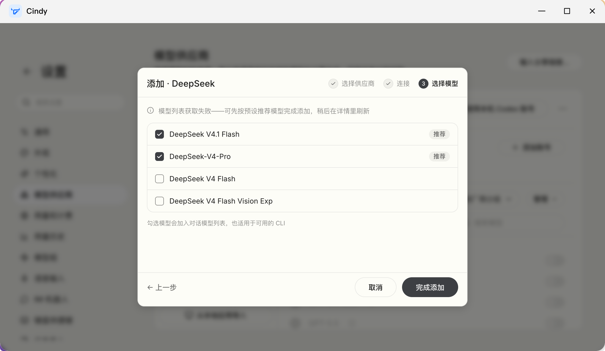

# Issue 草稿：独立 Host 的网页端支持添加自带 API Key 的供应商

> 状态：**已提交**（经用户审阅）：https://github.com/makecindy/cindy/issues/10644
> 模板：`.github/ISSUE_TEMPLATE/feature_request.yml`（功能建议），标题前缀 `feat: `。
> 先只提功能建议、请维护者确认方向，不附实现；涉及凭据写入，很可能触发维护者确认门（参考 #10429 / #10437）。
> 查重（2026-11-15）：按「Host 供应商 API Key」「createCustomProvider」「网页 添加供应商」「Host custom provider」「独立 Host 模型供应商」「BYOK host」搜索 issue 和 PR，没有重复。
> 代码位置按上游 `main` `b975dc3` 核对。
> 截图：同目录 `add-deepseek-models-failed.png`（维护者 2026-11-15 拍摄）。提交时换成固定到提交的链接。**截图说明**：窗口外框（标题栏 Cindy 与最小化/最大化/关闭按钮）是飞牛 fnOS 桌面的应用窗口；窗口内是上游原版 renderer。

**标题**：`feat(host): 独立 Host 的网页端支持添加自带 API Key 的供应商`

---

### 使用场景 / Use case

在 NAS 或 Linux 服务器上运行独立 Host、通过浏览器使用 Cindy 时，想像桌面版一样在「设置 → 模型供应商 → 添加供应商」里接入自己的 API Key，例如 DeepSeek，让任务用自己的账号和额度。

我们在飞牛 fnOS 上打包独立 Host（只带 Pi）。登录 Cindy 账号后，Cindy AI 提供的模型可以正常使用；但用户手里已有 DeepSeek 的 Key，希望直接用它。

### 当前问题 / Current limitation

网页端能打开「添加供应商」，也能选到 DeepSeek 预设并走完三步，但做不完：

1. 「选择模型」一步显示「模型列表获取失败——可先按预设推荐模型完成添加」；
2. 点「完成添加」后报错，供应商没有保存。

（截图的窗口外框是飞牛 fnOS 桌面的应用窗口，窗口内是原版 renderer。）

原因是网页端没有这组接口：

- `apps/web/shim.js` 和 `hostChannelContract` 里没有 `maker.createCustomProvider` / `updateCustomProvider` / `disconnectCustomProvider` / `deleteCustomProvider` / `fetchProviderModels`（桌面对应 `maker:provider:custom:*` 和拉取模型的 IPC），Host 的 `service.mjs` 也没有对应路由。
  - `createCustomProvider` 等写方法被 shim 拒绝为不支持，所以保存报错；
  - `fetchProviderModels` 以 `fetch` 开头，落进 shim 的读方法兜底，解析为 `null`，界面显示为「获取失败」，而不是「不支持」。
- `cindy-host` 也没有添加供应商的命令行子命令。

Host 其实已经能**读取**自定义供应商：`apps/host/src/agent/provider-config.ts` 复用 Desktop 的 `custom-provider-store`，并通过 Host 的加密凭据存储读写供应商 Key 和请求头。缺的是从客户端**写入**的入口。

上游计划里也有这一项：`docs/host/headless-runtime-plan.md` 的「账号、供应商、设置」一行要求「供应商连接……必须能完成」；`docs/host/channel-coverage.md` 把 `maker:provider:custom:create/update/delete/disconnect` 等列为 A 类（应由后台处理），目前都未接入。

### 期望方案 / Proposed solution

请维护者先确认方向和排期。我们的设想：

- Host 通过 `hostChannelContract` 提供自定义供应商的创建、更新、断开、删除，以及拉取模型列表；业务逻辑与 Desktop 的供应商处理共用，不另写一套，Key 和请求头继续写入 Host 现有的加密凭据存储；
- 这些写操作和其他写接口一样，要求已鉴权的控制端；
- 在实现之前，网页端这几个入口按「未支持的入口须明确不可用」（`docs/host/basic-web.md`）处理：至少让 `fetchProviderModels` 明确报不支持，而不是返回 `null` 显示成「获取失败」。

如果方向可以，我们愿意参与实现或验证（我们有 linux-arm64 的 fnOS 环境可以实测）。

### 已考虑的替代方案 / Alternatives considered

- **给 `cindy-host` 增加添加供应商的子命令**：能解决无图形环境下的配置，但 NAS 用户通常没有终端，体验远不如沿用现有的设置界面。
- **在 Host 外直接写数据库和凭据文件**：绕过了 `custom-provider-store` 与凭据存储的规则，不可取。
- **使用 Cindy AI 提供的 DeepSeek 模型**：可以用，但走的是 Cindy 账号的额度，不是用户自己的 Key。
