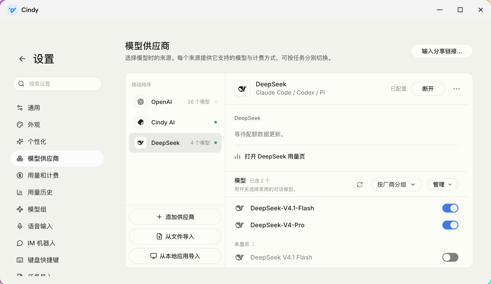
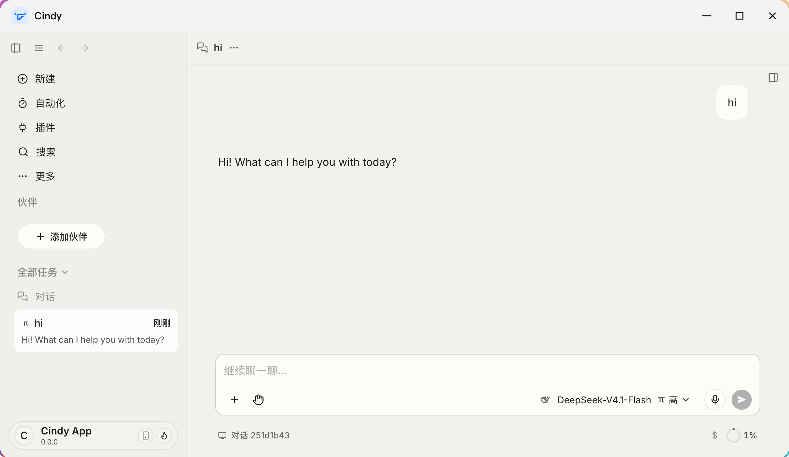

# feat(host): 支持在网页端创建自定义供应商并拉取模型

## 这次改了什么

### 摘要

独立 Host 网页端的添加供应商向导原先无法保存自带 API Key 的供应商，模型发现也因通道缺失返回空值。现在接入创建和模型发现两个契约通道，复用 Desktop 的 `registerProviderHandlers`，配置与凭据仍由 Host 原有存储管理。

提交顺序为行为不变的 Desktop 依赖拆分在前、Host 功能在后。共享 handler 通过端口调用平台能力，Desktop 在 `providerHandlers.desktop.ts` 绑定原函数，Host 注入现有 availability policy。模型发现的桌面 OAuth 读取与默认 transport 移到 `provider-model-fetch.desktop.ts`，纯 URL 推导与请求构造继续共用。

Host 创建成功后通过现有 SSE 广播供应商变更，Web shim 将该事件转发给 `maker.onProvidersChanged`，其他已打开的标签页随即按现有逻辑刷新目录。

### 变更类型

- [x] `feat` 新功能
- [ ] `fix` 缺陷修复
- [ ] `refactor` / `perf` 重构或性能优化
- [ ] `docs` / `test` / `chore` 文档、测试或工程维护
- [ ] 其他：

### 范围

- 关联 Issue / 需求：Refs https://github.com/makecindy/cindy/issues/10644 （本 PR 为第一阶段；更新、删除、断开后续跟进）
- 本 PR 包含：`maker:provider:custom:create`、`maker:provider:models-fetch` 的共享契约、Host 鉴权路由、Desktop handler 注册与 Host 依赖装配、回归测试及兼容说明；必要的 Desktop 平台装配拆分；共用严格凭据快照读取；现有 Host 构建守卫增加拒绝 `original-fs`。
- 明确不包含：更新、删除、断开；通用 IPC 写协议；CLI 导入；renderer 改动；shim 的通用读取兜底调整。
- 用户可见变化：已配对的网页端可通过原有向导创建自定义供应商并拉取模型；其他已连接的标签页会收到供应商变更通知。
- 是否存在 breaking change：无。增量通道，既有数据与接口不变。

### UI 变化

未修改界面代码；原有添加供应商向导已接通后台操作。以下截图来自 fnOS VM 实机验收，窗口标题栏和外框属于 fnOS 桌面，窗口内容是 Cindy 原版界面，本项目未添加页面元素；截图未出现 API Key。





- 引用的设计规范：不涉及：未修改组件、布局、样式或文案。

## 怎么验证的

### 自动验证

本次审阅修复的 HEAD 为 `0fa621005b`（`7e9ad7e3dc` + `0fa621005b`），基于 `f9f9d4df90`。本机已通过 JavaScript 语法检查、`git diff --check` 和两笔提交的 DCO 检查。把回归用例放到修复前的代码上运行，Linux 上复现失败，订阅回调一次也没有执行。修复后的定向检查在 Linux（Debian 12 arm64）上执行。

| Linux 检查 | 结果 |
| --- | --- |
| `node --import tsx --import ./src/loaders/register-raw.mjs --test src/web-shim.test.mjs`（在 `apps/host`） | 20/20 通过，墙钟 0.440s |
| 同一命令运行 `src/agent/provider-config.test.mjs` | 6/6 通过，墙钟 3.176s |
| `pnpm --filter @cindy/maker-shared exec vitest run src/__tests__/hostChannelContract.test.ts` | 9/9 通过 |
| `NODE_OPTIONS=--max-old-space-size=8192 pnpm --filter @cindy/host typecheck` | 通过 |
| `pnpm check:dev-docs` | 15/15 通过 |

以下为变基前 `10d381c30e` 在 Linux 上的历史验证，供确认原功能覆盖。

```text
# 从 apps/host 执行
node --import tsx --import ./src/loaders/register-raw.mjs --test src/agent/provider-config.test.mjs src/web-shim.test.mjs
结果：25/25 通过，2s

# 从仓库根目录执行
pnpm --filter @cindy/host test
结果：525/525 通过，31s
NODE_OPTIONS=--max-old-space-size=8192 pnpm --filter @cindy/host typecheck
结果：PASS，40s
pnpm --filter @cindy/maker-shared test -- src/__tests__/hostChannelContract.test.ts
结果：118 文件、2522/2522 通过，4s
pnpm --filter @cindy/maker-shared run --if-present typecheck
结果：PASS，1s

pnpm --filter desktop exec vitest run src/main/maker-ipc/__tests__/providerHandlers.test.ts src/main/maker-host/__tests__/providerModelFetch.test.ts src/main/maker-host/__tests__/genericOAuth.test.ts src/main/maker-host/__tests__/providerDetection.test.ts src/renderer/lib/__tests__/customProviders.test.ts src/main/voice-conversation/__tests__/openrouter.test.ts
结果：6 文件、561/561 通过（含企业连接权限检查），19s
pnpm --filter desktop typecheck
结果：PASS，235s；分片合计 10288 文件

pnpm --filter desktop exec vitest related --run src/main/maker-host/customProviderHeaderService.ts src/main/maker-host/generic-oauth.ts src/main/maker-host/provider-model-fetch.desktop.ts src/main/maker-host/provider-model-fetch.ts src/main/maker-ipc/providerHandlers.desktop.ts src/main/maker-ipc/providerHandlers.ts src/main/maker-ipc/register.ts
结果：427 文件中 422 通过、5 跳过；15660 用例中 15622 通过、38 跳过、0 失败，376s

pnpm check:test-hygiene
结果：PASS，336 files，30s
pnpm check:dev-docs
结果：11/11 通过
```

测试价值（规则依据均为 #10644）：

- `apps/host/src/agent/provider-config.test.mjs`：通过生产 `createHostService` 和 `createHostProviderConfig`，验证无 caller 的 403、真实 SQLite 配置与加密凭据、重复 ID、凭据失败回滚、发现输入校验、已存秘密端点绑定、旧 owner 拒绝及损坏密文的严格读取 / 显式替换（未传 Key 的创建沿用 Desktop 语义，不修改遗留密文）。现有 auth / provider-route 测试未覆盖 Host 创建入口。最小输入分别为无 caller、一个 Pi 配置、非法 URL、头写入失败与换账号；integration tier，内存 SQLite 和临时凭据，无外网/CLI。未单独计时；与 `web-shim.test.mjs` 合跑实测 2s。
- `apps/host/src/web-shim.test.mjs`：调用构建后的浏览器 shim 公共方法，验证向导参数及结果穿过真实共享契约，并保留三个未接通写方法的不支持错误。原有测试不覆盖这两个供应商方法。#11050 的回归用例经浏览器 shim 的真实 SSE 解码入口注入一帧 `maker:provider:changed`，断言另一个标签页的公开订阅恰好收到一次回调；向导 RPC 测试不覆盖推送。最小输入为 create 的三个参数、一个 discovery input，以及独立的一帧无 payload 的变更通知；unit tier，修复后单文件墙钟 0.440s。
- `packages/maker-shared/src/__tests__/hostChannelContract.test.ts`：调用导出的 client adapter，验证创建三参数、模型发现结构化失败结果的 wire 形状。现有契约缺少此二通道；最小输入为 create / fetch 各一次；unit tier。未单独计时；maker-shared 118 文件整包验证实测 4s。

### 手工验证

已在 fnOS linux-arm64 VM 验收通过：安装包 fpk `0.1.4` 的 Cindy 代码为当时的 `main` 加上本 PR 与 #11047、#11048、#11049，其中本 PR 部分等于变基前的 `120186e4ba` + `10d381c30e`。使用国际版账号经网页登录，Host 仅打包 Pi。

1. 网页端「设置 → 模型供应商 → 添加供应商」选择 DeepSeek 预设，填写真实 API Key，成功拉取 4 个模型。
2. 保存后供应商显示「已配置」，列出 Claude Code / Codex / Pi 三个 runtime；此次实际执行仅验证 Pi。
3. 选择 `DeepSeek-V4.1-Flash` 发送消息，收到流式回复。
4. VM 强制断电重启后 Host 自动启动，DeepSeek 供应商仍在，`connected=true`，三个 runtime 各保留 4 个模型；加密 Key 可正常解密，凭据存储正常。

证据见上方 [供应商已配置](deepseek-provider-configured.png) 和 [流式回复](deepseek-streamed-reply.png) 截图，未出现 Key。

开销按代码推导：每次创建一次 Host 请求，一次存在性查询、一次配置 INSERT；凭据按现有三个 runtime 的 mutation 计划做有界读写，成功后一次全量本地自定义供应商目录刷新与一次变更事件。订阅者沿用原有刷新逻辑，不新增轮询。模型发现每次一个 Host 请求，下游复用 Desktop 的超时、分页与兼容端点回退，次数由供应商响应决定，不增加额外重试。回包字节及通知累计压力未实测。凭据同步 IO 沿用现有存储接口，仅用于显式创建/发现操作。

### 未执行的验证

修复后 Linux 定向检查见上表。推送前在提交者 fork 上手动运行了本仓 `client-ci`（与本 PR 两个提交合并后的 tree 相同，基于 `f9f9d4df90`）：26 项中 24 项通过，包括 8 个 Linux 单测分片、8 个 Windows 单测分片、Typecheck、verify-checks，以及 Ubuntu、Windows 上的 Host regressions；`Host regressions (macos-latest)` 在 fork 上排队 20 分钟未分到 macOS 机器而被取消，汇总项 `verify` 因此未通过，macOS 结果以本 PR 的 CI 为准。变基后的双标签页实机流程、回包字节和通知累计压力未实测；macOS 与 Windows 实机未验证。

## 风险

### 风险分类

- [ ] 无已知风险
- [ ] SQLite / migration
- [ ] system prompt
- [x] 协议兼容
- [x] 权限 / 安全 / 用户数据
- [ ] 存量插件兼容（批准状态 / 指纹 / manifest 校验 / 安装布局 / 包格式）
- [ ] 原生层 / fingerprint / OTA
- [ ] 跨平台差异
- [ ] 其他：

### 影响与回滚

- 影响范围：独立 Host 创建供应商及代理模型发现。必须由认证传输提供 caller；沿用 Desktop 校验、owner generation、串行事务、凭据暂存/回滚与请求头端点绑定。未改数据库 schema、加密格式、默认模型、服务端或插件基座。Desktop 装配保留传入依赖对象身份及注册后的读取函数替换；handler 平台操作仍以原顺序调用相同函数，模型发现的 OAuth 主体原样移动；相关现有测试改为经过 Desktop 装配文件。
- 协议兼容：新增两个契约路径；新 Host 可服务旧客户端，新客户端连接旧 Host 时需升级 Host。通用 IPC 仍只读，不改 relay wire。
- 回滚 / 降级方式：回退代码后网页两个入口恢复不可用；已写入的配置和加密凭据仍可由现有运行期读取，不删除用户数据。
- 存量插件影响：无。

与 #11047（子路径）和 #11048（网页登录）都涉及 `apps/web/shim.js`。彼此会有文本冲突；无论先合入哪一个，其余 PR 都由提交者变基跟进，并重新跑 Web shim 回归。

### 提交前检查

- [x] 已 review 完整 diff
- [x] 每个 commit 都带 DCO 签名（`git commit -s`，见 [DCO](https://github.com/makecindy/cindy/blob/main/DCO)）
- [x] UI 改动已在「UI 变化」注明引用的设计规范章节（不涉及 UI 则跳过）
- [x] 未提交凭证、令牌或授权文件
- [x] 已核对受影响的文档，行为变化涉及的旧结论已同步修订（不涉及则无需修改文档）
- [x] 已确认测试结果或说明未执行原因
- [x] 涉及读取、刷新和写入开销已在「怎么验证的」记录推导与未测项。
