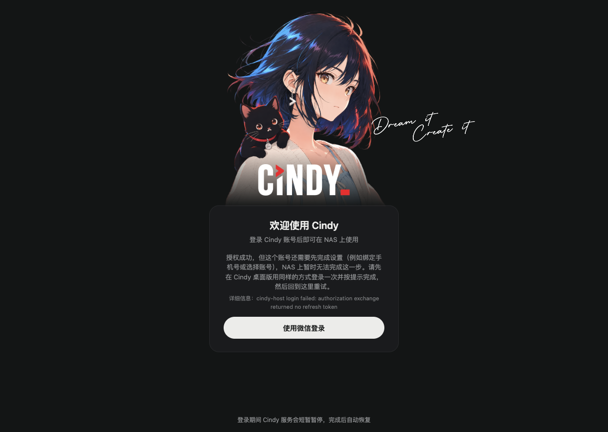

# Issue 草稿：cindy-host login 遇到绑定手机号或选择账号时报「no refresh token」

> 状态：**草稿，待用户审阅**
> 模板：`.github/ISSUE_TEMPLATE/bug_report.yml`（缺陷报告）。
> 背景：飞牛版 P1 的网页首次登录包装了 `cindy-host login --method=wechat --no-open`；维护者用微信授权后，Host 报 `authorization exchange returned no refresh token`。
> 未确认的事实：服务器这次返回的具体是哪一种结果（CLI 的报错没有带上），下文按代码推断，已如实写明。
> 对照（2026-11-15）：同一 VM 改用国际版 + Apple 登录成功。
> 截图：同目录 `wechat-no-refresh-token.png`（提交时上传到 issue）。2026-11-15 在全新安装的中国大陆版上由维护者用微信授权后拍摄；页面是飞牛版自己包装 CLI 的登录页，「详细信息」一行是 `cindy-host login` 的原始报错。

**标题**：`bug: cindy-host login 的授权码兑换结果不是 ok 时（需绑定手机号、选择账号）只报 no refresh token`

---

### 问题描述 / What happened

在无图形的 Linux 上用中国大陆版 Host 执行 `cindy-host login --method=wechat --no-open`，在浏览器里完成微信授权后，命令失败：

```text
cindy-host login failed: authorization exchange returned no refresh token
```

`apps/host/src/auth/login.mjs` 的 `runHostLogin` 把 `exchangeAuthorizationCode` 的结果当作 token pair：

```js
const pair = await deps.client.exchangeAuthorizationCode(authorization.code, verifier);
if (!pair?.refreshToken) throw new Error('authorization exchange returned no refresh token');
```

而 `exchangeAuthorizationCode` 返回的是 `loginOutcomeSchema`（`packages/auth-client/src/types.ts`），共有四种 `status`：`ok`、`select_account`、`binding_required`、`sso_verification_required`。只有 `ok` 带 `refreshToken`，其余三种都会落到上面这条报错。Desktop 的 `acceptLoginOutcome`（`apps/desktop/src/main/authManager.ts`）会继续引导用户选择账号、绑定手机号或完成验证，Host 没有对应处理。

作为对照，同一套环境把区域换成国际版（`CINDY_HOST_REGION=global`），用 `cindy-host login --method=apple --no-open` 登录成功，Host 重启后 `account.authenticated=true`、`runtime.state=ready`。说明托管回调与授权码兑换本身可用；结合上面的代码，微信这次的失败应是兑换结果不是 `ok`。

中国大陆版的账号以手机号为准（`GET https://auth.cindy.com.cn/api/auth/providers` 返回 `"attribution":"phone"`，`social: ["wechat","apple"]`），所以第一次用微信登录、尚未绑定手机号的用户，很可能会遇到 `binding_required`。CLI 的报错没有带上 `status`，这次具体是哪一种无法确认。

期望：

1. 至少在报错中说明服务器返回的结果类型（例如「这个微信需要先绑定手机号，请先在 Cindy 桌面版登录并完成绑定」），而不是 `no refresh token`；
2. 能处理时继续完成登录：`select_account` 让用户选择账号，`binding_required` 引导绑定。

相关：`docs/host/architecture-and-status.md` 已说明 Host「只支持浏览器社交登录；email/phone 验证码流程未实现」。对中国大陆版来说，社交登录又常常需要绑定手机号，这两点叠在一起，无图形环境下新用户无法完成首次登录。

### 环境 / Environment

- Cindy 版本或 commit：`main` `b975dc3`（独立 Host 发行包）
- 平台与版本：linux-arm64，飞牛 fnOS 1.2.1010（Debian 12），无 Secret Service；`CINDY_HOST_REGION=cn`
- 安装方式：源码构建独立 Host（`pnpm --filter @cindy/host build`），以服务方式运行；登录前已停止 Host
- 本地补丁：构建另带 Web 子路径、凭据密钥文件、依赖去重、启动检查等补丁，均未改动 `apps/host/src/auth/login.mjs`、`login-cli.mjs` 和 `main.ts`；凭据密钥文件补丁只在兑换成功后写入会话时才会用到，本次在兑换结果检查处就已失败。同一构建用国际版 + Apple 登录成功

### 复现步骤 / Steps to reproduce

1. 准备一个尚未在 Cindy 中国大陆版绑定手机号的微信账号（这个微信之前未登录过 Cindy、未绑定过手机号）
2. 停止 Host，执行 `CINDY_HOST_REGION=cn cindy-host login --method=wechat --no-open`
3. 在浏览器打开输出的授权链接，用微信完成授权
4. 命令以 `authorization exchange returned no refresh token` 失败

### 日志与截图 / Logs & screenshots

```text
Open the following Cindy login page on a device with a browser.
If it does not open, visit:
https://auth.cindy.com.cn/api/auth/social/wechat/authorize?client_type=desktop&device_id=…&redirect_uri=https%3A%2F%2Fauth.cindy.com.cn%2Fapi%2Fauth%2Fdesktop%2Fcallback&code_challenge=…&code_challenge_method=S256&client_state=…
cindy-host login failed: authorization exchange returned no refresh token
```

下图需要说明一下，以免误会：

- **这不是 Cindy 的界面。** 截图里的页面是飞牛版自己写的登录页（仿照 Cindy 原版登录页的样式），用来在 NAS 上包装 `cindy-host login`；
- **页面上的中文提示不是 Cindy 的文案。**「授权成功，但这个账号还需要先完成设置……请先在 Cindy 桌面版用同样的方式登录一次……」是我们针对这个报错写的说明；
- **只有「详细信息：」后面的英文是 `cindy-host login` 的原始输出**，来自 `apps/host/src/main.ts`（`cindy-host login failed:` 前缀）和 `apps/host/src/auth/login.mjs`。


