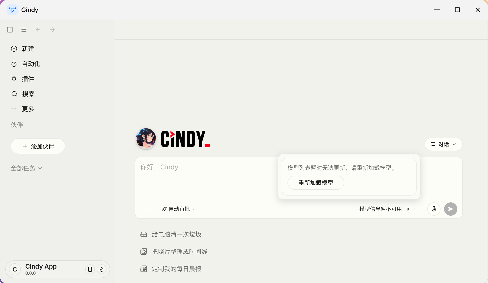
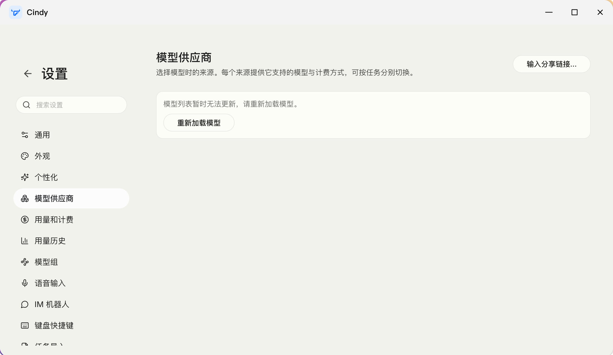
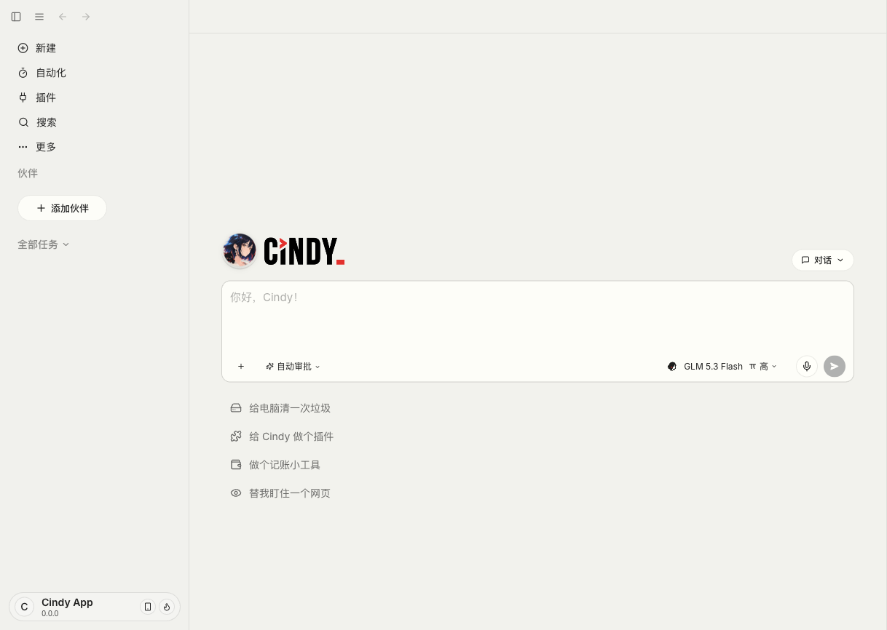

# Issue 草稿：只打包 Pi 的独立 Host，网页端模型目录始终「暂时无法更新」

> 状态：**草稿**，待用户审阅。
> 模板：`.github/ISSUE_TEMPLATE/bug_report.yml`（缺陷报告）。
> 修复 PR 草稿见同目录 `pr.md`（分支 `fix/capabilities-unregistered-agents`）。
> 查重（2026-11-15）：按「is not registered capabilities」「模型列表暂时无法更新」「loadLocalCapabilitiesSnapshot」等搜索 issue 和 PR，没有重复；最相关的是已关闭的 #1467（Pi 下载超时导致供应商页为空）及其修复 #1468。
> 截图：同目录 `before-home.png`、`before-providers.png`（维护者 2026-11-15 拍摄）、`after-home.png`。提交时上传到 issue，替换下文的相对路径。**截图说明**：窗口外框（标题栏 Cindy 与最小化/最大化/关闭按钮）是飞牛 fnOS 桌面的应用窗口，不是 Cindy 的界面；窗口内是上游原版 renderer，没有改动界面代码。

**标题**：`bug: 只打包 Pi 的独立 Host，网页端模型目录始终显示「模型列表暂时无法更新」`

---

### 问题描述 / What happened

用 `--harnesses pi-bin,ripgrep-bin` 构建只带 Pi 的独立 Host（#10418），登录后在网页端：

- 新建任务的模型选择处显示「模型信息暂不可用」，弹出「模型列表暂时无法更新，请重新加载模型」，点「重新加载模型」也一样；
- 「设置 → 模型供应商」只有同一条提示，看不到任何供应商和模型。

Host 本身是正常的：`POST /api/capabilities {"agentKind":"pi"}` 返回 200 和完整的模型列表，`/api/providers` 也返回 200。失败的只有：

```text
POST /api/capabilities {"agentKind":"claude-code"} → 404 {"error":"agent_not_registered","message":"Agent 'claude-code' is not registered"}
POST /api/capabilities {"agentKind":"codex"}       → 404 {"error":"agent_not_registered","message":"Agent 'codex' is not registered"}
```

原因在 renderer 的 `loadLocalCapabilitiesSnapshot`（`apps/desktop/src/renderer/hooks/useAgentCapabilities.ts`）：它对 Claude Code、Codex、Pi 三个 agent 都请求能力，只容忍 Pi 未注册（#1468），Claude Code 或 Codex 未注册时整轮刷新失败，`refreshLocalCatalogSnapshot` 因此保留空快照并显示 `catalog-unavailable`。

#1468 有意保留了核心 agent 的原子失败语义：桌面版里 Claude Code 和 Codex 一定存在，它们失败只可能是临时故障。但 #10418 之后，独立 Host 的发行包可以不包含它们，这时「未注册」是这个 runtime 的固定状态，不是临时故障。

期望：只打包部分 agent 时，模型目录按 runtime 实际注册的 agent 正常显示；桌面版的行为不变。

### 环境 / Environment

- Cindy 版本或 commit：`main` `b975dc3`
- 平台与版本：linux-arm64，Debian 12（飞牛 fnOS 1.2.1010 虚拟机）；浏览器 Chromium
- 安装方式：源码构建独立 Host，`--harnesses pi-bin,ripgrep-bin`；国际版账号（Apple 登录）。我们的构建另带 Web 子路径、凭据密钥文件等补丁，均不涉及 `useAgentCapabilities.ts`

### 复现步骤 / Steps to reproduce

1. `pnpm --filter desktop exec vite build --config vite.renderer.config.ts`
2. `pnpm --filter @cindy/host build --output /tmp/cindy-host --harnesses pi-bin,ripgrep-bin`
3. 启动 `/tmp/cindy-host/cindy-host` 并登录 Cindy 账号，在浏览器中打开网页端（我们的环境经由注入 Host bearer 的反向代理访问）
4. 新建任务页的模型处显示「模型信息暂不可用」；「设置 → 模型供应商」显示「模型列表暂时无法更新，请重新加载模型」

### 日志与截图 / Logs & screenshots

新建任务页：



设置 → 模型供应商：



（截图的窗口外框是飞牛 fnOS 桌面的应用窗口，窗口内是原版 renderer。）

在已构建的 renderer 中临时让这里不再因为 Claude Code / Codex 未注册而失败后，同一个 Host 的模型选择器立即正常显示 Pi 的模型（这是验证原因用的临时改动，修复方案见关联 PR）：


