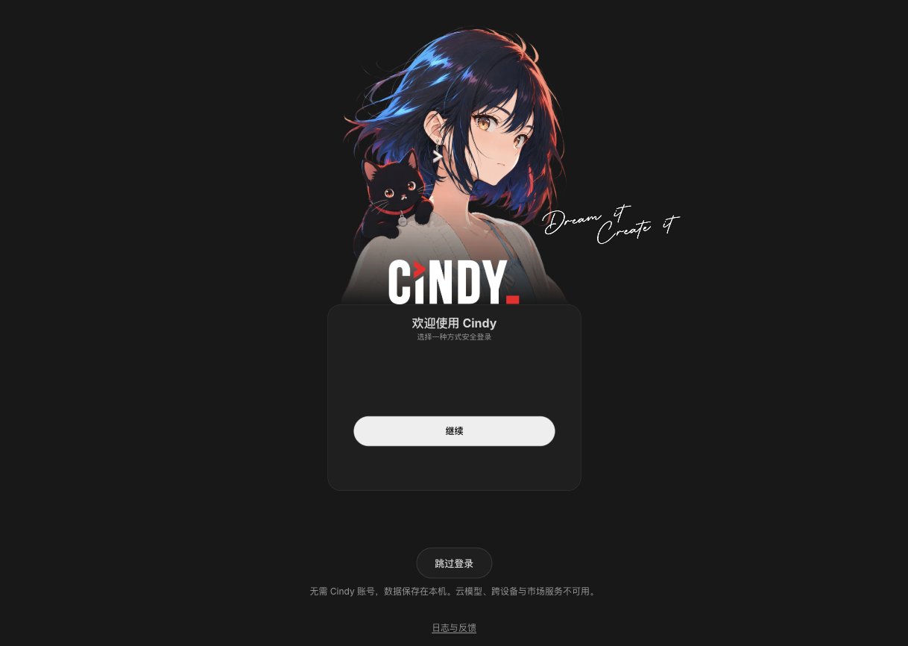

# Issue 草稿：独立 Host 的网页端无法完成首次登录

> 状态：**已提交**（经用户审阅）：https://github.com/makecindy/cindy/issues/10600
> 模板：`.github/ISSUE_TEMPLATE/feature_request.yml`（功能建议）。
> 背景：飞牛版目前用 Adapter 包装 `cindy-host login` 作为过渡（见 `docs/architecture.md`「用户旅程」）；本 issue 请求上游在 Host 里提供网页端登录。
> 依赖：网页端要先越过启动检查才能看到登录页，见 `docs/upstream/web-env-check/`。
> 截图：同目录 `login-page-without-methods.png`（提交时上传到 issue）。拍摄于 2026-11-15，飞牛 fnOS 虚拟机，国际版，全新安装、未登录，已带启动检查的修复。

**标题**：`feat(host): 独立 Host 的网页端支持首次登录与重新登录`

---

### 使用场景 / Use case

在没有图形界面的 Linux 设备上（NAS、家用服务器、容器）运行独立 Host，用户只能通过浏览器使用 Cindy。用户希望在浏览器里打开 Cindy 后，像桌面版一样直接在原版登录页完成首次登录、过期重登和退出后重新登录，不需要 SSH 到设备上执行命令。

`docs/host/headless-runtime-plan.md` 也把这列为目标：「首次启动、登录、查看状态、查看日志、更新与停止都有可用入口，不要求打开 Electron 窗口」，以及「无图形首次登录、过期重登、供应商连接和退出必须能完成」。

### 当前问题 / Current limitation

1. **网页端没有登录入口。** Renderer 的登录页可以显示（解决启动检查问题后），但 `apps/web/shim.js` 没有实现登录所需的接口：`authGetLoginState` 固定返回 `{ step: 'entry' }`，登录页里不出现任何登录方式（国际版本应有邮箱、Apple、Google），只有一个「继续」按钮；退出登录后跳转到 `/connect`。

   
2. **唯一的登录方式是 CLI，而且要先停掉 Host。** `cindy-host login` 在 Host 运行时报错 `Stop Cindy Host before changing its sign-in, then start it again.`。所以网页端无法在 Host 运行期间发起登录；外部包装只能「停止 Host → 运行 CLI → 重启 Host」，期间服务中断。
3. **CLI 只支持社交登录。** `docs/host/architecture-and-status.md` 已注明「只支持浏览器社交登录；email/phone 验证码流程未实现」。中国大陆版的账号以手机号为准（`/api/auth/providers` 返回 `"attribution":"phone"`），国际版的邮箱验证码需要 Turnstile 人机验证（`captcha.requiredFor: ["email_request_code"]`）。另外，社交登录的兑换结果不是 `ok` 时（需绑定手机号、选择账号）CLI 直接失败，单独报告见 #<host-login-outcomes issue>。

实测（2026-11-15，独立 Host `b975dc3`，飞牛 fnOS 虚拟机）：通过外部包装 CLI，国际版 Apple 登录成功并进入主界面；中国大陆版微信登录因上面第 3 点失败。

### 期望方案 / Proposed solution

由 Host 在运行期间提供网页端登录，让 Renderer 原有的登录页直接可用：

- Host 承担与桌面版 `authManager` 相同的登录流程（获取登录方式、社交登录的托管回调、手机号/邮箱验证码与人机验证、选择账号、绑定、企业 SSO 验证），复用 `packages/auth-client` 与桌面版中与平台无关的部分；
- `apps/web/shim.js` 把登录页用到的接口转发到 Host，取代固定的 `{ step: 'entry' }`；
- 登录在 Host 运行期间完成并切换到新账号，不需要停止进程；退出登录后回到登录页，而不是 `/connect`。

是否分阶段（例如先支持社交登录与选择账号，再支持验证码）由维护者决定。

### 已考虑的替代方案 / Alternatives considered

- **外部包装 `cindy-host login`**（飞牛版目前的做法）：自建一个登录页，点击后停止 Host、运行 CLI、把授权链接交给页面、完成后重启 Host。可以用于社交登录，但无法覆盖手机号/邮箱验证码、选择账号和绑定；登录期间 Host 不可用；而且要在 Host 之外复刻一部分登录交互。
- **在网页端重写桌面版的登录状态机**：等于把 `authManager` 的大部分逻辑复制到 shim 或外部代码中，与上游实现强耦合，不可取。
