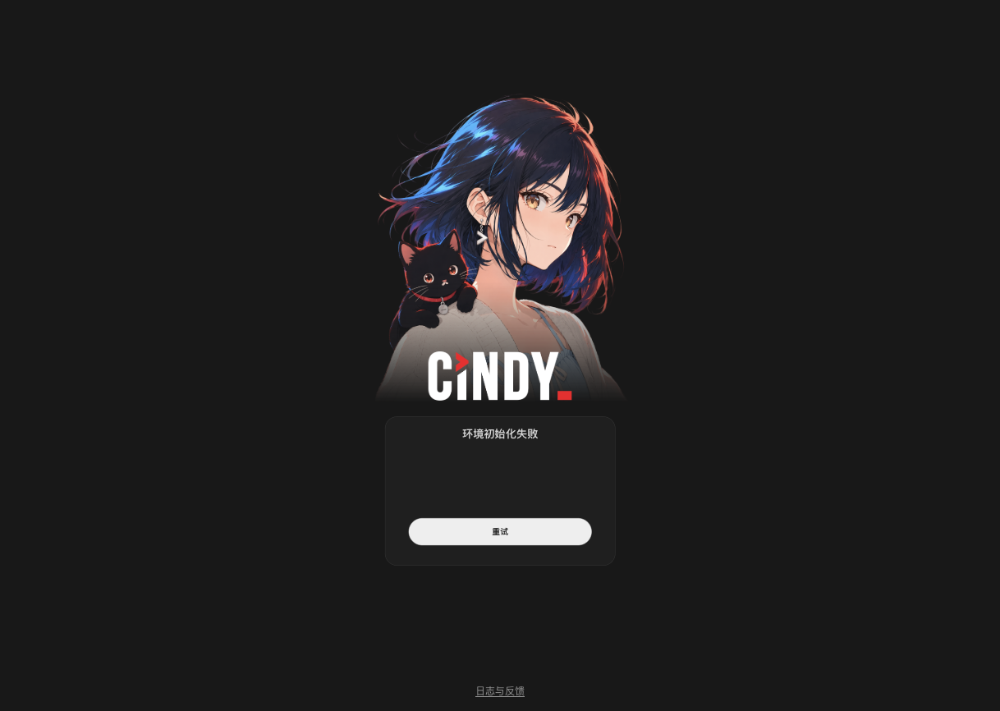
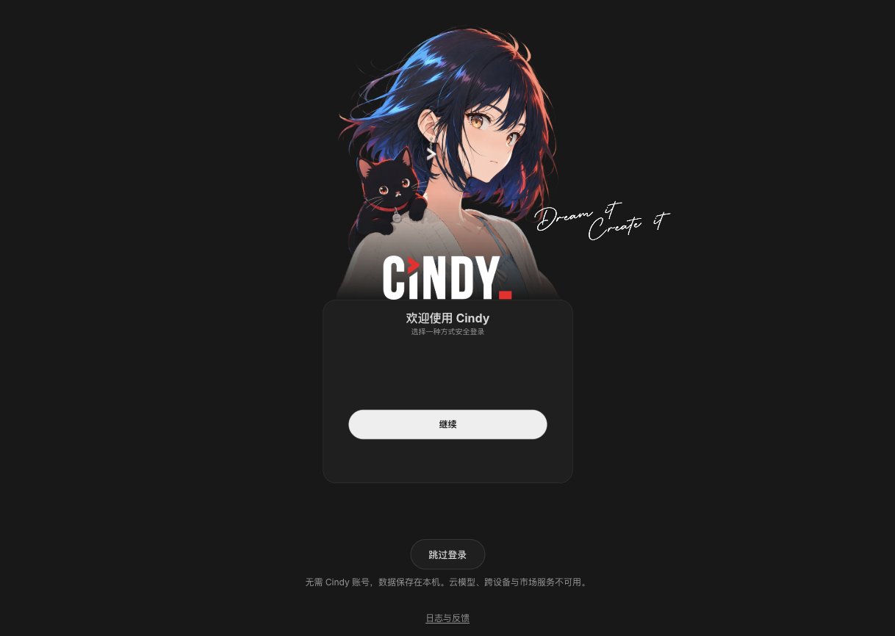

# Issue 草稿：只打包部分 harness 的 Host，网页端卡在「环境初始化失败」

> 状态：**草稿，待用户审阅**
> 模板：`.github/ISSUE_TEMPLATE/bug_report.yml`（缺陷报告）。
> 对应本地补丁 `patches/0006-web-env-check-bundled-harnesses.patch`；修复 PR 草稿见同目录 `pr.md`。
> 截图：同目录 `before-env-failed.png`、`after-login-page.png`（提交时上传到 issue，替换下文的相对路径）。拍摄于 2026-11-15，飞牛 fnOS 虚拟机，全新安装、未登录；「修复前」为临时把发行包中 `shim.js` 的这一行换回上游原文后拍摄。

**标题**：`bug: 用 --harnesses 只打包 Pi 的独立 Host，网页端启动检查永远失败`

---

### 问题描述 / What happened

#10418 合入后，`pnpm --filter @cindy/host build --harnesses pi-bin,ripgrep-bin` 可以构建只带 Pi 的独立 Host。用浏览器打开这样的 Host，网页端始终停在启动页「环境初始化失败」，点「重试」也一样，进不了登录页和主界面。

原因在 `apps/web/shim.js` 的 `checkEnvironment`：

```js
const allPassed = Boolean(harness['claude-code'] && harness.codex);
```

它要求 Claude Code **和** Codex 都就绪。只打包 Pi 时，`/health` 的 `harness` 是 `{"claude-code":false,"codex":false,"pi":true}`，`allPassed` 恒为 `false`，`EnvCheckContext` 因此把状态设为 `failed`。而 Host 本身运行正常：登录后 `runtime.agents` 为 `["pi"]`，Pi 任务可以使用。

期望：只要发行包里有任意一个已就绪的 Agent，启动检查就通过；一个 Agent 都没有时仍然失败。

### 环境 / Environment

- Cindy 版本或 commit：`main` `b975dc3`
- 平台与版本：linux-arm64，Debian 12（飞牛 fnOS 1.2.1010）；浏览器 Chromium
- 安装方式：源码构建独立 Host，`--harnesses pi-bin,ripgrep-bin`（我们的构建另带 Web 子路径、凭据密钥文件等补丁，与本问题无关；`checkEnvironment` 未被改动）

### 复现步骤 / Steps to reproduce

1. `pnpm --filter desktop exec vite build --config vite.renderer.config.ts`
2. `pnpm --filter @cindy/host build --output /tmp/cindy-host --harnesses pi-bin,ripgrep-bin`
3. 启动 `/tmp/cindy-host/cindy-host`，以已授权的网页会话打开它（我们的环境是经由注入 Host bearer 的反向代理访问，未测试 Host 自带的网页配对流程）
4. 页面停在「环境初始化失败」，`/health` 的 `harness` 为 `{"claude-code":false,"codex":false,"pi":true}`

### 日志与截图 / Logs & screenshots

当前行为（只打包 Pi，未登录）：



把 `allPassed` 改为任一 Agent 就绪即通过后，同一个发行包显示登录页（登录方式为空的问题另见 #<host-web-login issue>）：



登录后进入主界面（`runtime.state=ready`、`agents=["pi"]`）。
