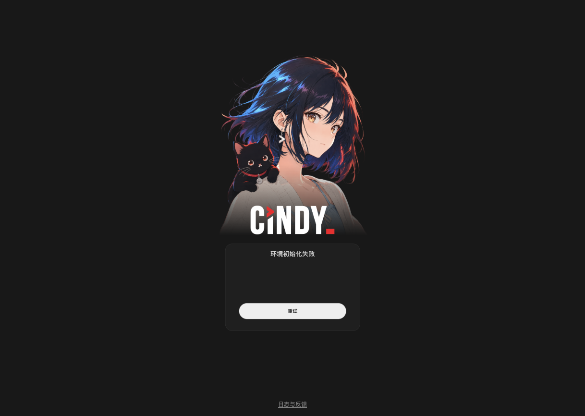
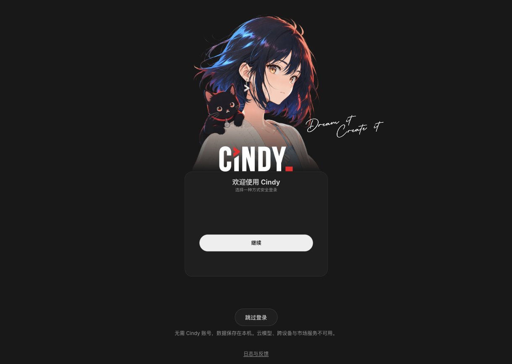

# PR 草稿：网页端启动检查接受只打包部分 Agent 的 Host

> 状态：**草稿，待用户审阅**
> 关联 issue：待提交（草稿见同目录 `issue.md`），提交后把下文的 `#<issue>` 换成编号
> 分支：本地 `.upstream/cindy` 中的 `fix/web-env-check-bundled-harnesses`，基于上游 `main`（`b975dc3`），1 个 commit，带 DCO 签名。尚未推送到 fork。
> 模板：上游 `.github/PULL_REQUEST_TEMPLATE.md`
> 验证数据均为实测（2026-11-15，linux-arm64，Debian 12，Node 22.22.3，pnpm 11.28.9）。

---

**标题**：`fix(web): 只打包部分 Agent 时网页端启动检查也能通过`

## 这次改了什么

### 摘要

`apps/web/shim.js` 的 `checkEnvironment` 要求 Claude Code 和 Codex 都就绪才算通过。#10418 之后，独立 Host 可以用 `--harnesses` 只打包部分 Agent（例如只带 Pi），这样的发行包在网页端永远停在「环境初始化失败」。本 PR 改为任意一个已打包的 Agent 就绪即通过；一个都没有时仍然失败。

### 变更类型

- [x] `fix` 缺陷修复

### 范围

- 关联 Issue / 需求：Closes #<issue>
- 本 PR 包含：
  - `apps/web/shim.js`：`allPassed` 改为 `claude-code`、`codex`、`pi` 任一就绪；
  - `apps/host/src/web-shim.test.mjs`：新增回归用例；测试辅助函数 `browser()` 额外返回 `window`，用来设置 `__cindyBoot`。
- 明确不包含：`checkEnvironment` 中各 Agent 的单项状态（`claudeCode`、`codex` 未打包时仍报 `failed`）；Desktop 的启动检查。
- 用户可见变化：只打包部分 Agent 的独立 Host，网页端能越过启动页进入登录页和主界面。打包全部 Agent 时行为不变。
- 是否存在 breaking change：无。

### UI 变化

不涉及：只改变启动检查的判定结果，没有界面、样式或文案改动。

- 引用的设计规范：不涉及。

## 怎么验证的

### 自动验证

```text
cd apps/host && node --import tsx --import ./src/loaders/register-raw.mjs --test src/web-shim.test.mjs
结果：17 pass，0 fail，约 250 ms
（只保留新测试、不带 shim.js 的修改：16 pass，1 fail，失败的正是新用例）
pnpm --filter @cindy/host test
结果：447 pass，0 fail
pnpm check:test-hygiene
结果：PASS（341 files within baseline）
```

测试价值（`web-shim.test.mjs`，补充到现有文件）
- 生产入口与可观察结果：浏览器 shim 公开的 `window.electronAPI.checkEnvironment()`，即 `EnvCheckContext` 决定是否进入应用的唯一依据；可观察结果是返回的 `allPassed`。
- 规则依据：#<issue>；`--harnesses` 允许只打包部分 Agent（#10418），`/health` 以 `harness` 报告每个 Agent 是否就绪。
- 现有覆盖为什么不够：现有用例没有调用 `checkEnvironment`。
- 最小失败输入与 tier：只有 Pi 就绪必须通过（修复前失败）；Claude Code 与 Codex 都就绪必须通过（原有行为）；没有任何 Agent 就绪必须失败。unit tier，复用文件内已构建的 shim，无 I/O。

### 手工验证

在 linux-arm64（飞牛 fnOS 1.2.1010 虚拟机）上，用 `--harnesses pi-bin,ripgrep-bin` 构建的发行包，经浏览器访问（我们通过注入 Host bearer 的反向代理访问，构建中另带与本问题无关的子路径等补丁）：

| | 修复前 | 修复后 |
|---|---|---|
| 网页端启动 | 停在「环境初始化失败」 | 显示登录页 |
| 截图 |  |  |
| 登录后 | — | 进入主界面；`/health`：`runtime.state=ready`、`agents=["pi"]` |

### 未执行的验证

- Host 自带的网页配对流程：我们的环境经由反向代理访问，未走配对页。
- 打包全部 Agent 的发行包：判定对这种情况不变（新用例覆盖了 Claude Code 与 Codex 都就绪的输入），没有另行构建验证。

## 风险

### 风险分类

- [x] 无已知风险

### 影响与回滚

- 影响范围：只影响浏览器 shim 的 `checkEnvironment` 判定；Desktop 不加载 shim。
- 回滚 / 降级方式：回退本 commit 即可。

### 提交前检查

- [x] 已 review 完整 diff
- [x] 每个 commit 都带 DCO 签名（`git commit -s`，见 [DCO](../DCO)）
- [x] UI 改动已在「UI 变化」注明引用的设计规范章节（不涉及 UI 则跳过）
- [x] 未提交凭证、令牌或授权文件
- [x] 已核对受影响的文档，行为变化涉及的旧结论已同步修订（不涉及则无需修改文档）
- [x] 已确认测试结果或说明未执行原因
- [x] 涉及数据读取、通知后刷新、界面频繁写入或常驻组件时，已在「怎么验证的」写明：每个用户动作
  和每次通知触发几次 list/扫描/IPC/写事务（读远程数据再写远程调用次数和回包字节），以及隐藏或
  卸载后是否停止（见 `docs/dev-rules/engineering-conventions.md` §8；远程读取同时见
  `docs/dev-rules/server-channel-review.md`）（不涉及）
