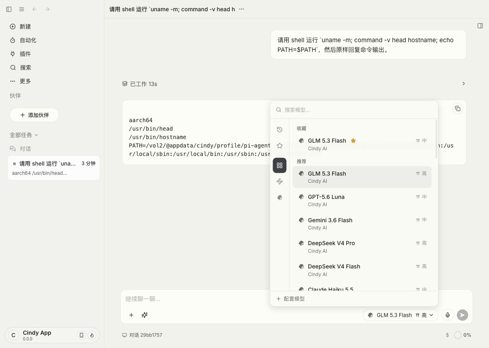

# Issue 草稿：网页端打开模型选择器时界面崩溃（modelGroups.get 返回 null）

> 状态：**已提交**（经用户审阅）：https://github.com/makecindy/cindy/issues/10641
> 模板：`.github/ISSUE_TEMPLATE/bug_report.yml`（缺陷报告）。
> 修复 PR 草稿见同目录 `pr.md`（分支 `fix/web-model-groups-unsupported`）。
> 查重（2026-11-15）：按「modelGroups」「模型组 网页」「界面出错了 模型」「Cannot read properties of null routes」搜索 issue 和 PR，没有重复。上游 `docs/host/channel-coverage.md` 把 `model-groups:*` 七个通道列为 A 类（应由后台处理），目前都未接入。
> 截图：没有崩溃时的截图，用错误详情代替。同目录 `after-picker.png` 是修复后的选择器（拍摄时 VM 上同时带有 capabilities 问题的临时修复，见 `../host-partial-harness-catalog/`，否则选择器里没有模型）。截图是网页端整页，没有飞牛窗口外框。

**标题**：`bug: 网页端打开模型选择器时界面崩溃：Cannot read properties of null (reading 'routes')`

---

### 问题描述 / What happened

在独立 Host 的网页端点击输入框右下角的模型选择器，整个主区域变成「界面出错了」，错误详情：

```text
TypeError: Cannot read properties of null (reading 'routes')
    at useModelGroupPickerRows (ModelGroupsPickerSection.tsx)
    at ModelGroupsPickerSection (ModelGroupsPickerSection.tsx)
```

（生产构建里函数名被压缩为 `Sk` / `Px`，位于 `PluginModelPickerHost-*.js`；对应源码 `apps/desktop/src/renderer/components/new-chat/ModelGroupsPickerSection.tsx` 的 `config.routes.map(...)`。）

原因：Host 还没有实现模型组，网页 shim 里也没有 `modelGroups.get`。shim 对未实现的读方法有一个通用兜底（`unsupported()`）：方法名以 `get` 开头、路径里又没有 list/status/config 等字样时，返回 `Promise.resolve(null)`。`modelGroupsClient.refreshModelGroups()` 把这个 `null` 当作模型组配置发布出去，选择器渲染时读 `config.routes` 就抛错了。

`refreshModelGroups()` 本来就会捕获 `modelGroups.get()` 的失败并保留内置的空默认值（`MODEL_GROUPS_DEFAULTS`），所以只要这个读取明确报「不支持」，而不是返回 `null`，选择器就能正常工作。

期望：网页端打开模型选择器不崩溃；Host 支持模型组之前，选择器里不显示模型组。

### 环境 / Environment

- Cindy 版本或 commit：`main` `b975dc3`
- 平台与版本：linux-arm64，Debian 12（飞牛 fnOS 1.2.1010 虚拟机）；浏览器 Chromium
- 安装方式：源码构建独立 Host（`--harnesses pi-bin,ripgrep-bin`）；国际版账号。构建另带 Web 子路径等补丁，均不涉及模型组和 shim 的读方法兜底

### 复现步骤 / Steps to reproduce

1. 构建并启动独立 Host，登录后在浏览器打开网页端
2. 让模型选择器有可选模型（只打包 Pi 时要先解决「模型列表暂时无法更新」的问题，见 #10640；打包全部 agent 时无此前提）
3. 点击输入框右下角的模型选择器
4. 主区域变成「界面出错了」，错误详情如上

按 `apps/web/shim.js` 中 `unsupported()` 的兜底规则，`window.electronAPI.modelGroups.get()` 会解析为 `null`（修复 PR 中的回归用例在 `main` 上即因此失败）。

### 日志与截图 / Logs & screenshots

错误详情见上。在 shim 中让 `modelGroups.get` 明确返回「不支持」后，同一个页面的模型选择器正常打开：


